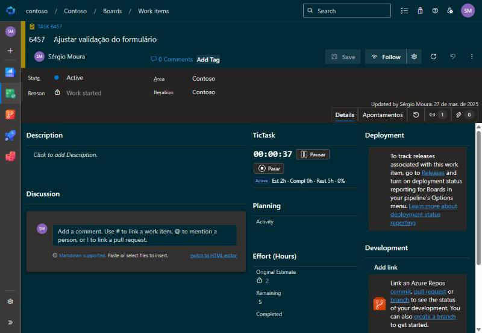
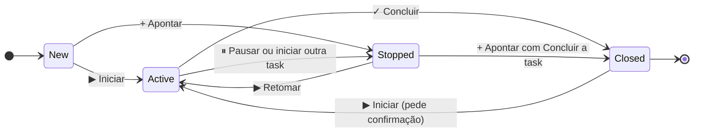
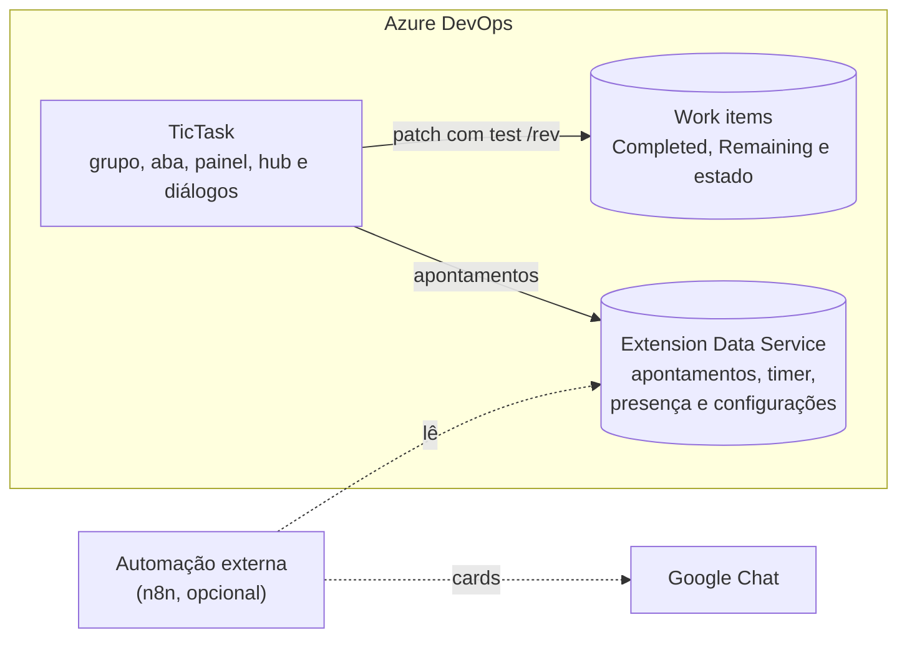

# TicTask – apontamento de horas no Azure DevOps

Extensão do Azure DevOps para apontar horas direto nas Tasks e User Stories/Bugs, com timer
(iniciar, pausar, concluir), **Remaining calculado automaticamente**, estado da task acompanhando o
trabalho, resumo por período e calendário. Sem backend: os dados ficam no *Extension Data
Service* do próprio Azure DevOps.



**[Site](https://ghmeyer0.github.io/azure-devops-tictask/) · [Documentação (wiki)](https://github.com/GHMeyer0/azure-devops-tictask/wiki) · [Pedir acesso](https://github.com/GHMeyer0/azure-devops-tictask/issues/new?template=pedir-acesso.yml)**

## O que faz

- **Timer** na tela do work item: iniciar, pausar e concluir. Pausar já aponta o tempo; nada fica
  pendente. Um timer por pessoa: iniciar outro pausa o atual.
- **Horas sempre batendo**: o *Completed Work* da task é a soma dos apontamentos e cada apontamento
  desconta do *Remaining Work*. Apontamento e task são gravados juntos: se a task recusar, o
  apontamento é desfeito e a pessoa é avisada. Uma conferência acha e ajusta tasks com o Completed
  editado à mão.
- **Na US/Bug**: escolha uma task sua ou crie uma nova pela descrição; crie as tasks padrão com um clique.
- **Estado da task** acompanha o trabalho, com motivos de pausa e próximo passo comentados na task e na US.
- **Hub TicTask** (Boards): Meu tempo, Resumo (com exportação em PDF e CSV), Calendário e, para
  gestores, Time agora e Configurações.
- **Auditoria**: cada apontamento guarda início, fim e pausas, quem apontou e a task antes e depois.
- **Migração**: importa o histórico da extensão Time Log pelo CSV dela.

## Como funciona

O estado da task diz quem está trabalhando nela:



| Estado | Significa |
|---|---|
| **Active** | Alguém está com o timer nela agora |
| **Stopped** | Começada, ninguém trabalhando nela agora (aparece em **Paradas**) |
| **Closed** | Terminada |

Cada apontamento grava as horas no work item (uma revisão no *History*) e o detalhe no Extension Data
Service:



## Documentação

| Para | Páginas |
|---|---|
| Quem usa | [Usar numa Task](https://github.com/GHMeyer0/azure-devops-tictask/wiki/Usar-numa-Task) · [Usar numa User Story ou Bug](https://github.com/GHMeyer0/azure-devops-tictask/wiki/Usar-numa-User-Story-ou-Bug) · [Rotinas internas](https://github.com/GHMeyer0/azure-devops-tictask/wiki/Rotinas-internas) · [Telas do TicTask](https://github.com/GHMeyer0/azure-devops-tictask/wiki/Telas-do-TicTask) · [Perguntas frequentes](https://github.com/GHMeyer0/azure-devops-tictask/wiki/Perguntas-frequentes) |
| Quem administra | [Instalar](https://github.com/GHMeyer0/azure-devops-tictask/wiki/Instalar) · [Preparar o processo](https://github.com/GHMeyer0/azure-devops-tictask/wiki/Preparar-o-processo) · [Configurar o TicTask](https://github.com/GHMeyer0/azure-devops-tictask/wiki/Configurar-o-TicTask) · [Migrar dados](https://github.com/GHMeyer0/azure-devops-tictask/wiki/Migrar-dados) · [Lembretes no Google Chat](https://github.com/GHMeyer0/azure-devops-tictask/wiki/Lembretes-no-Google-Chat) |
| Quem desenvolve | [Arquitetura](https://github.com/GHMeyer0/azure-devops-tictask/wiki/Arquitetura) · [Contribuir](https://github.com/GHMeyer0/azure-devops-tictask/wiki/Contribuir) |

As páginas da wiki ficam em [`docs/wiki/`](docs/wiki/Home.md) e são publicadas na aba Wiki a cada push
na `main`: para corrigir a documentação, abra um pull request.

## Desenvolvimento

```bash
npm install
npm test            # vitest
npm run typecheck   # tsc
npm run package     # gera out/<publisher>.tictask-<versão>.vsix
```

Stack: TypeScript, React 19, Fluent UI v9, `azure-devops-extension-sdk` 4.2, FullCalendar 6, esbuild e
vitest. Estrutura, armadilhas, versão e a pipeline de publicação estão em
[Contribuir](https://github.com/GHMeyer0/azure-devops-tictask/wiki/Contribuir).

## Licença

[MIT](LICENSE).
