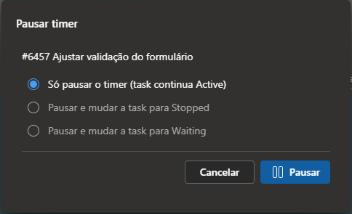
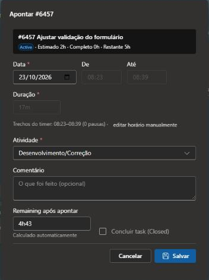
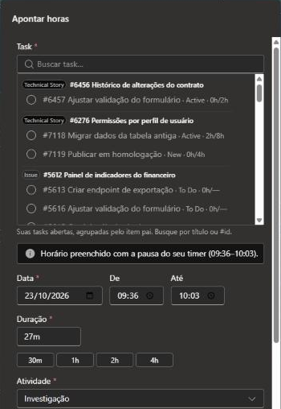
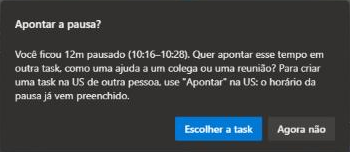
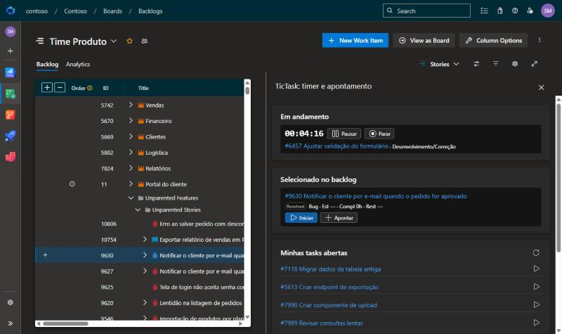
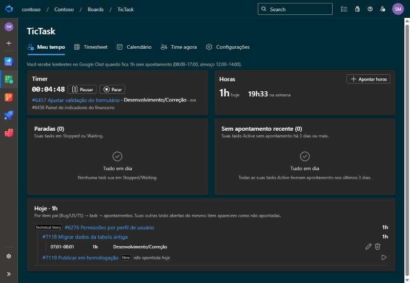

# TicTask – Como usar

O TicTask registra as horas trabalhadas direto nas **Tasks** do Azure DevOps. Você inicia um timer
(ou aponta manualmente), e a extensão atualiza sozinha o *Completed Work*, o *Remaining Work* e o
estado da task. Tudo fica no histórico do work item: quem apontou, quanto e quando.

> **Resumo rápido**
> 1. Abra a Task (ou a US/Bug) e clique em **▶ Iniciar**.
> 2. Precisou parar um pouco? **⏸ Pausar**. Voltou? **▶ Retomar**.
> 3. Terminou? **⏹ Parar**: o apontamento abre preenchido. Confira e clique em **Salvar**.
> 4. Acompanhe o seu dia em **Boards › TicTask › Meu tempo**.

## Sumário

- [Onde o TicTask aparece](#onde-o-tictask-aparece)
- [Trabalhando numa Task](#trabalhando-numa-task)
  - [Timer: iniciar, pausar e parar](#timer-iniciar-pausar-e-parar)
  - [Apontar horas manualmente](#apontar-horas-manualmente)
  - [Remaining automático](#remaining-automático)
  - [Estado da task](#estado-da-task)
  - [Voltar para uma task depois](#voltar-para-uma-task-depois)
- [Trabalhando numa User Story ou Bug](#trabalhando-numa-user-story-ou-bug)
  - ["O que você vai fazer?"](#o-que-você-vai-fazer)
  - [Tasks padrão](#tasks-padrão)
  - [Revisor na US de outra pessoa](#revisor-na-us-de-outra-pessoa)
  - [Ajudar alguém no meio do seu trabalho](#ajudar-alguém-no-meio-do-seu-trabalho)
- [Aba Apontamentos](#aba-apontamentos)
- [Painel no backlog](#painel-no-backlog)
- [Hub TicTask](#hub-tictask)
  - [Meu tempo](#meu-tempo)
  - [Timesheet](#timesheet)
  - [Calendário](#calendário)
  - [Time agora (gestores)](#time-agora-gestores)
  - [Configurações (gestores)](#configurações-gestores)
- [Lembretes no Google Chat](#lembretes-no-google-chat)
- [Perguntas frequentes](#perguntas-frequentes)

---

## Onde o TicTask aparece

| Onde | O que tem |
|---|---|
| Tela do work item, aba **Details** | Grupo **TicTask** com Iniciar / Pausar / Parar / Apontar e as horas da task |
| Tela do work item, aba **Apontamentos** | Todos os apontamentos da task (ou das tasks filhas, na US/Bug) |
| **Boards › Backlogs / Sprints**, painel lateral | Timer em andamento, item selecionado e suas tasks abertas |
| **Boards › TicTask** | Meu tempo, Timesheet, Calendário e, para gestores, Time agora e Configurações |

Você só pode ter **um timer por vez**. Ele continua contando mesmo com o navegador fechado, porque o
TicTask guarda apenas os horários de início e de pausa.

---

## Trabalhando numa Task

### Timer: iniciar, pausar e parar

Na aba **Details** da Task, o grupo **TicTask** mostra os botões do timer e um resumo das horas
(**Est**imado · **Compl**eto · **Rest**ante), com uma barra de quanto da estimativa já foi consumido.

- **▶ Iniciar** começa o timer na task.
  - Se você já tiver um timer em outra task, o TicTask avisa: para iniciar o novo, o atual é parado e
    você aponta esse tempo antes.
  - Se outra pessoa estiver com timer na mesma task, ele também avisa (e deixa iniciar mesmo assim).
- **⏸ Pausar** pausa o timer. Na pausa você pode, se quiser, mudar a task para **Stopped** e
  escrever o motivo, que vai para a discussão da task.
- **▶ Retomar** continua de onde parou. Cada retomada vira um novo trecho no apontamento.
- **⏹ Parar** abre o diálogo de apontamento já preenchido com o início, o fim e as pausas.

O timer em andamento também aparece no topo do **Meu tempo** e no **painel do backlog**, então dá para
pausar ou parar sem voltar à task.

### Apontar horas manualmente

Use **+ Apontar** para registrar algo que você já fez sem o timer.

| Campo | Como funciona |
|---|---|
| **Data, De, Até** | Quando foi o trabalho. Ao mudar o início ou a duração, o fim é recalculado. |
| **Duração** | Aceita `1h30`, `1,5`, `90m`. Os atalhos 30m / 1h / 2h / 4h preenchem na hora. |
| **Atividade** | Investigação, Desenvolvimento/Correção, Revisão, Testes, Reunião, Outros. Vem sugerida pelo título da task. |
| **Comentário** | O que foi feito (opcional). |
| **Remaining após apontar** | Calculado automaticamente; pode ser ajustado. |
| **Concluir task** | Fecha a task (Closed) junto com o apontamento. Aparece em destaque quando o Remaining zera. |

Quando o apontamento vem do timer, os campos de horário mostram os **trechos** (ex.: `09:00–12:00 ·
13:00–14:30`, 1 pausa). Para corrigir os horários à mão, clique em **editar horário manualmente**.

### Remaining automático

A cada apontamento:

- **Completed Work** = Completed + horas apontadas
- **Remaining Work** = Remaining − horas apontadas (nunca abaixo de zero), **editável** no diálogo

Se a task ainda não tem **Original Estimate**, o primeiro apontamento pede a estimativa. Editar um
apontamento aplica só a diferença; excluir devolve as horas ao Remaining.

Horas, Remaining e estado vão numa única gravação, o que gera uma só revisão no **History** do work item.

### Estado da task

O apontamento acompanha o estado da task (as regras ficam em [Configurações › Estados](#configurações-gestores)):

| Quando | O que acontece |
|---|---|
| Iniciar timer ou apontar numa task **New / Stopped** | A task vai para **Active** |
| Iniciar trabalho numa task filha de uma US em **New / Ready for Development** | A US vai para **Active** |
| Pausar | Opcional: **Stopped**, com motivo na discussão |
| Parar o timer para iniciar outro | Opcional: **Stopped**, para a task aparecer em **Paradas** |
| Marcar **Concluir task** | A task vai para **Closed** |
| Apontar numa task **Closed** | Pede confirmação e reabre para **Active** (ou bloqueia, conforme a configuração) |

> **O processo precisa ter o estado "Stopped" na Task.** É ele que o TicTask usa para "parar e
> retomar depois". A extensão não cria estados no processo: isso exige ser administrador do processo
> e daria a todos os usuários da extensão permissão para alterar o processo da organização. Se
> o estado não existir, um administrador cria em *Organization settings › Process › (seu processo) ›
> Task › States › New state*: nome **Stopped**, categoria **In Progress**. Outro nome também serve:
> configure em *Configurações › Estados › Ao pausar, oferecer*. Estados configurados que o tipo de
> task não tem (ex.: um "Waiting" removido do processo) simplesmente não aparecem na pausa.

### Voltar para uma task depois

Só existe um timer por pessoa. Para começar outra coisa sem perder a task atual de vista:

1. Clique em **▶ Iniciar** na outra task. O TicTask avisa que vai parar o timer atual.
2. No apontamento do timer que está sendo parado, marque **Deixar a task em Stopped para retomar
   depois**.
3. A task vai para **Paradas**, no Meu tempo. Quando voltar a ela, o **▶** dali inicia um timer novo
   e a task volta para **Active**.

Cada volta vira um apontamento separado, e o total da task é a soma deles. Exemplo: você revisou o
PR de um colega e agora espera ele resolver os comentários. Deixe a sua task de revisão em Stopped e
volte para a sua própria task; quando o colega terminar, retome a revisão pelas Paradas.

---

## Trabalhando numa User Story ou Bug

Na US, Technical Story ou Bug, o grupo **TicTask** soma as horas das tasks filhas e oferece
**▶ Iniciar**, **+ Apontar** e **Tasks padrão**.

Se o seu timer estiver rodando em outra task, ele aparece logo abaixo dos botões, com pausar e parar.

### "O que você vai fazer?"

**▶ Iniciar** e **+ Apontar** na US/Bug abrem este diálogo:

- **Minhas tasks**: as suas tasks abertas na US. Escolha uma e confirme a atividade.
- **Outras tasks**: as tasks de outras pessoas (expanda para ver).
- **Nova task**: escolha a atividade, a estimativa e escreva a descrição, que vira o título da task
  (ex.: `Revisão: Revisão de PR`). A task nasce **atribuída a você**, com a mesma área e iteração da US.
- Se faltarem tasks padrão na US, dá para marcar **Criar também as tasks padrão que faltam**.

Depois de confirmar, o timer começa (ou o apontamento abre) na task escolhida ou criada.

### Tasks padrão

**Tasks padrão** cria de uma vez as tasks combinadas para toda US/Bug (Investigação,
Desenvolvimento/Correção, Revisão e Testes), com estimativa e título sugeridos. Só aparecem as que
ainda faltam na US.

### Revisor na US de outra pessoa

Quem vai revisar entra na US do colega, clica em **▶ Iniciar**, escolhe **Nova task** com a atividade
**Revisão** e descrição **Revisão de PR**. A task é criada atribuída ao revisor, e as horas dele não se
misturam com as do dev.

### Ajudar alguém no meio do seu trabalho

Você está com o timer na sua task e precisa ajudar um colega na US dele. Não pare o seu timer:

1. **⏸ Pausar** o seu timer ("Só pausar o timer").
2. Ajude o colega.
3. Na US dele, clique em **+ Apontar** e escolha **Nova task** (ex.: atividade *Revisão* ou *Outros*,
   descrição "Apoio ao fulano"). O horário **já vem preenchido com a sua pausa**. Confira e salve.
4. Volte para a sua task e clique em **▶ Retomar**.

Se você retomar antes de apontar, o TicTask pergunta se quer apontar o tempo da pausa em outra task
(a partir de 10 minutos de pausa, fora do horário de almoço). "Escolher a task" abre o apontamento
com o horário da pausa. "Agora não" deixa para depois: o próximo **+ Apontar** em outro item ainda
vem com o horário da pausa, até que ela seja apontada.

Não use **▶ Iniciar** na US do colega nesse caso: com um timer seu aberto, o TicTask pede para parar
e apontar o atual antes, porque só existe um timer por pessoa.

---

## Aba Apontamentos

A aba **Apontamentos** do work item mostra o histórico completo:

- **Na Task**: cada apontamento com data, início–fim, pausas, atividade, horas e comentário, com totais
  por pessoa e por atividade. O autor pode editar ou excluir (até o limite de dias configurado).
- **Na US/Bug**: as tasks filhas com estimado, completo e restante, alertas de inconsistência (ex.: task
  fechada com Remaining, task ativa sem apontamento) e a linha do tempo de todos os apontamentos.

---

## Painel no backlog

Em **Boards › Backlogs** ou **Sprints**, abra o painel lateral (ícone de painel no canto direito) e
escolha **TicTask**. Ele mostra:

- **Em andamento**: o timer atual, com pausar e parar;
- **Selecionado no backlog**: o item clicado na lista, com **Iniciar** e **Apontar**;
- **Minhas tasks abertas**: as suas 10 tasks abertas mais recentes, com **Iniciar**.

---

## Hub TicTask

Em **Boards › TicTask** (primeiro item do menu do Boards). Todo mundo vê **Meu tempo**, **Timesheet** e
**Calendário** com os próprios apontamentos; gestores veem também os de todo o time, mais **Time
agora** e **Configurações**.

### Meu tempo

O painel do seu dia.

- **Timer**: o que está rodando agora, com pausar e parar.
- **Horas**: total de hoje e da semana, e o botão **Apontar horas** (escolha a task na lista, agrupada
  pelo item pai).
- **Paradas**: suas tasks em Stopped, para retomar com um clique.
- **Sem apontamento recente**: suas tasks Active sem apontamento há 3 dias ou mais.
- **Hoje**: os apontamentos do dia em árvore (item pai › task › apontamentos), com editar e excluir.
  Suas outras tasks abertas do mesmo item pai aparecem como "não apontada hoje", com ▶ para iniciar.

### Timesheet

Horas por dia da semana, como uma planilha.

- **◀ Esta semana ▶** navega por semana; **De / até** escolhe qualquer período.
- **Agrupar**: Usuário › Task › Atividade, Usuário › Item pai › Task, entre outros.
- **Detalhado**: mostra cada apontamento.
- **Exportar**: resumo ou apontamentos detalhados em CSV (abre no Excel).
- Gestores escolhem **Quem**: eu, uma pessoa ou o time todo.

### Calendário

Seus apontamentos na semana ou no dia, como uma agenda. Cada bloco mostra o item pai, a task, o horário
e a atividade.

- **Arraste num horário vazio** para apontar naquele intervalo.
- **Arraste ou redimensione um bloco** para corrigir o horário (Completed e Remaining da task são
  ajustados).
- **Clique num bloco** para editar, duplicar ou excluir.
- O timer em andamento aparece como um bloco listrado.
- Gestores escolhem em **Calendário de** de quem é a agenda (a de outras pessoas é só leitura).

### Time agora (gestores)

Quem está com timer rodando ou pausado e em qual task. Atualiza a cada 30 segundos; timer aberto há
mais de 10h aparece em vermelho (provável esquecimento).

### Configurações (gestores)

Configurações por projeto, organizadas em seções. As alterações só valem depois de **Salvar**, no
rodapé, que também tem **Descartar** e **Restaurar padrão**.

| Seção | O que configura |
|---|---|
| **Geral** | Tipos pai (User Story, Technical Story, Bug) e tipo de task; gestores adicionais; registrar o apontamento na discussão da task; dias até bloquear a edição; visão do time ligada/desligada |
| **Atividades** | Nome, cor, título sugerido, campo *Activity* do ADO, estimativa padrão e quais são tasks padrão |
| **Estados** | Estado ativo e fechados; o que acontece ao iniciar, pausar e concluir; regra para task fechada; ativação do item pai |
| **Google Chat** | Lembrete de apontamento (expediente, almoço, máximo por dia), quem recebe e o resumo da manhã |
| **Dados** | Exportar e importar todos os apontamentos e configurações do projeto (JSON) |

**Gestores** são os administradores de qualquer time do projeto, mais os e-mails adicionados em
*Geral › Gestores*.

---

## Lembretes no Google Chat

Configurados em **Configurações › Google Chat** e enviados por mensagem direta pelo app do Google Chat.

**Lembrete de apontamento** (dias úteis):

- A cada hora cheia, o TicTask olha a hora que acabou (ex.: às 10h, a janela 9h–10h).
- Avisa quem **não apontou nada** nessa janela e **não está com timer rodando**.
- Fora do expediente (padrão 8h–17h) e nas janelas que cruzam o almoço (padrão 12h–14h), não há lembrete.
- Cada pessoa recebe no máximo **2 lembretes por dia** (configurável).

**Resumo da manhã**: às 7h30 dos dias úteis, junto com os WIs e PRs, vem **"O que fiz ontem"**, com os
apontamentos do dia útil anterior em árvore (item pai › tasks) para ajudar na daily.

Para receber, a pessoa precisa estar marcada em **Quem recebe** e ter uma conversa (DM) aberta com o
app no Google Chat.

---

## Perguntas frequentes

**Fechei o navegador com o timer rodando. Perdi as horas?**
Não. O timer guarda só os horários, então continua contando. Ao voltar, pare e confira o apontamento.

**Esqueci o timer ligado a noite toda.**
Pare normalmente e, no diálogo, clique em **editar horário manualmente** para corrigir o fim. Também dá
para ajustar o bloco depois pelo **Calendário**.

**Apontei na task errada.**
Exclua o apontamento (Meu tempo › Hoje, aba Apontamentos ou Calendário) e aponte de novo na task
certa. A exclusão devolve as horas ao Remaining da task errada.

**Não consigo editar um apontamento antigo.**
A edição fica bloqueada depois de alguns dias (definido em *Configurações › Geral*). Fale com um gestor.

**Por que o Remaining não ficou como eu esperava?**
Ele é calculado como Remaining − horas apontadas, mas você pode digitar outro valor no campo
**Remaining após apontar** antes de salvar.

**Não vejo Time agora nem Configurações.**
São só para gestores (administradores de time ou e-mails listados nas configurações).

**Não recebo os lembretes no Google Chat.**
Confira com um gestor se você está em *Configurações › Google Chat › Quem recebe* e se você já abriu
uma conversa (DM) com o app no Google Chat.
