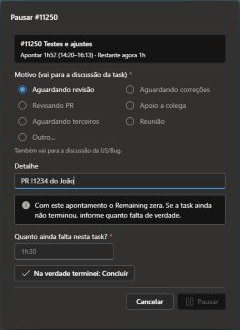
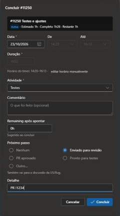
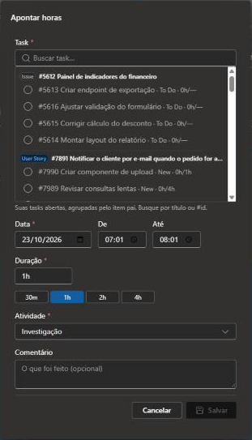
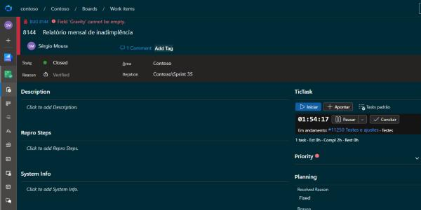
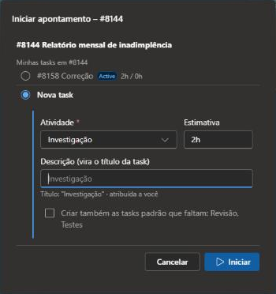
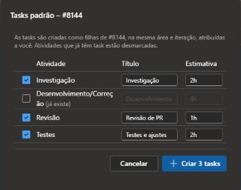
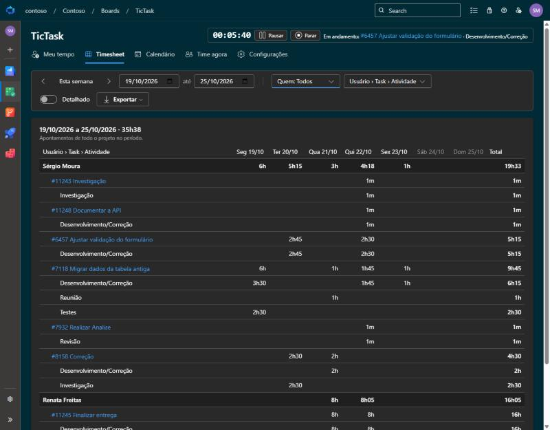

# TicTask – Como usar

O TicTask registra as horas trabalhadas direto nas **Tasks** do Azure DevOps. Você inicia um timer
(ou aponta manualmente), e a extensão atualiza sozinha o *Completed Work*, o *Remaining Work* e o
estado da task. Tudo fica no histórico do work item: quem apontou, quanto e quando.

> **Resumo rápido**
> 1. Vai trabalhar numa task? Abra a Task (ou a US/Bug) e clique em **▶ Iniciar**.
> 2. Largou a task por agora (outra task, reunião, fim do dia)? **⏸ Pausar**: o tempo já é apontado
>    e a task vai para **Paradas**. Para voltar, **▶ Retomar** nas Paradas.
> 3. Terminou a task? **✓ Concluir**: confira o apontamento e a task é fechada.
> 4. Acompanhe o seu dia em **Boards › TicTask › Meu tempo**.
>
> Pausar não é intervalo: café não precisa pausar. O TicTask mede o esforço em cada task, não é ponto.

## Sumário

- [Onde o TicTask aparece](#onde-o-tictask-aparece)
- [Trabalhando numa Task](#trabalhando-numa-task)
  - [Timer: iniciar, pausar e concluir](#timer-iniciar-pausar-e-concluir)
  - [Pausar com motivo](#pausar-com-motivo)
  - [Concluir e próximo passo](#concluir-e-próximo-passo)
  - [Apontar horas manualmente](#apontar-horas-manualmente)
  - [Remaining automático](#remaining-automático)
  - [Estado da task](#estado-da-task)
  - [Trocar de task no meio do trabalho](#trocar-de-task-no-meio-do-trabalho)
- [Trabalhando numa User Story ou Bug](#trabalhando-numa-user-story-ou-bug)
  - ["O que você vai fazer?"](#o-que-você-vai-fazer)
  - [Tasks padrão](#tasks-padrão)
  - [Fluxo de revisão de PR](#fluxo-de-revisão-de-pr)
  - [Ajudar alguém no meio do seu trabalho](#ajudar-alguém-no-meio-do-seu-trabalho)
- [Aba Apontamentos](#aba-apontamentos)
- [Painel no backlog](#painel-no-backlog)
- [Hub TicTask](#hub-tictask)
  - [Meu tempo](#meu-tempo)
  - [Timesheet](#timesheet)
  - [Calendário](#calendário)
  - [Time agora (gestores)](#time-agora-gestores)
  - [Configurações (gestores)](#configurações-gestores)
- [Lembretes no Google Chat](#lembretes-no-google-chat)
- [Perguntas frequentes](#perguntas-frequentes)

---

## Onde o TicTask aparece

| Onde | O que tem |
|---|---|
| Tela do work item, aba **Details** | Grupo **TicTask** com Iniciar / Pausar / Concluir / Apontar e as horas da task |
| Tela do work item, aba **Apontamentos** | Todos os apontamentos da task (ou das tasks filhas, na US/Bug) |
| **Boards › Backlogs / Sprints**, painel lateral | Timer em andamento, item selecionado e suas tasks abertas |
| **Boards › TicTask** | Meu tempo, Timesheet, Calendário e, para gestores, Time agora e Configurações |

Você só pode ter **um timer por vez**. Ele continua contando mesmo com o navegador fechado, porque o
TicTask guarda apenas o horário de início.

---

## Trabalhando numa Task

### Timer: iniciar, pausar e concluir

Na aba **Details** da Task, o grupo **TicTask** mostra os botões do timer e um resumo das horas
(**Est**imado · **Compl**eto · **Rest**ante), com uma barra de quanto da estimativa já foi consumido.

| Botão | Quando usar | O que acontece |
|---|---|---|
| **▶ Iniciar** (ou **▶ Retomar**, nas Paradas) | "Vou trabalhar nisso agora" | O timer começa e a task vai para **Active**. Se você tinha um timer em outra task, ele é pausado sozinho. |
| **⏸ Pausar** | "Larguei esta task por agora, mas não terminei": outra task, reunião, revisão, aguardando alguém, almoço, fim do dia | Um clique: o tempo é apontado, sai do Remaining, a task vai para **Stopped** e aparece em **Paradas**. |
| **⏸ ▾** (seta do Pausar) | Igual, quando vale registrar o porquê | Abre o diálogo de motivo. Veja [Pausar com motivo](#pausar-com-motivo). |
| **✓ Concluir** | "Terminei esta task" | Abre o apontamento para conferir o horário e o Remaining (sugerido 0). A task vai para **Closed**. |
| **+ Apontar** | Esqueci o timer, ou é trabalho já feito | Abre o apontamento manual. |

Cada pausa vira uma linha de apontamento. Exemplo: iniciou às 11:30, pausou às 11:45, retomou às 12:15 e
pausou de novo às 14:00. São duas linhas (11:30–11:45 e 12:15–14:00), 2h no total. O intervalo entre
elas é o tempo em que você não estava na task, e não é descontado.

- Se outra pessoa estiver com timer na mesma task, o TicTask avisa (e deixa iniciar mesmo assim).
- Um timer pausado com menos de 1 minuto (clique sem querer) não gera apontamento, e a task volta ao
  estado anterior.
- **Timer esquecido**: se o timer está rodando desde um dia anterior, ou há mais de 10h
  (configurável), as telas avisam e o **Pausar** pergunta até que horas você trabalhou, para não
  apontar a noite toda.

O timer em andamento também aparece no topo do **Meu tempo** e no **painel do backlog**, então dá para
pausar ou concluir sem voltar à task.

### Pausar com motivo

A seta **▾** ao lado do **Pausar** abre o diálogo com os motivos. O motivo e o detalhe (ex.:
"PR !1234 do João") vão para a discussão da task: `⏸ Pausada: Aguardando revisão. PR !1234 do João`.
Também aparecem em **Paradas**, ao lado da task.

| Motivo | Quando usar | Também comenta na US |
|---|---|---|
| Aguardando revisão | Subi o PR (ou as correções) e espero a revisão | Sim |
| Aguardando correções | Revisei o PR e espero o autor ajustar os comentários | Sim |
| Revisando PR | Parei a minha task para revisar o PR de alguém | Não |
| Apoio a colega | Parei para ajudar alguém | Não |
| Aguardando terceiros | Dependo de cliente, infra ou uma dúvida de negócio | Sim |
| Reunião | Saí para uma reunião | Não |
| Outro… | Escreva o motivo | Não |

Os motivos marcados com "Também comenta na US" escrevem também na discussão da US/Bug, para quem
acompanha a história: `⏸ #11222 Correção (Ana): Aguardando revisão. PR !1234`. Os outros ficam só na
task, para não notificar todo mundo que segue a US. A lista é configurável em *Configurações › Estados e
motivos*.

Em "Revisando PR" e "Apoio a colega", o tempo da revisão ou da ajuda vai numa task da revisão ou da
ajuda, com timer nela. O motivo só explica por que a sua task parou.

O diálogo de pausa também abre sozinho quando há algo a confirmar:

- **Timer esquecido**: pede até que horas você trabalhou.
- **Remaining zerado**: se a task já estava com Remaining 0, ou a pausa vai zerá-lo, o TicTask pergunta
  **"Quanto ainda falta nesta task?"**. Informe o valor real, ou clique em **Na verdade terminei:
  Concluir**. Assim o estouro da estimativa aparece (Completed maior que o estimado) em vez de ficar
  escondido num Remaining 0.
- **Task sem estimativa**: pede a estimativa.

### Concluir e próximo passo

**✓ Concluir** abre o apontamento com o horário do timer e o Remaining sugerido como 0 (dá para
mudar). Em **Próximo passo**, opcional, diga o que vem depois:

| Próximo passo | Quando usar |
|---|---|
| Enviado para revisão | Terminei o desenvolvimento e abri o PR |
| PR aprovado | Revisão terminada, ou correções aprovadas |
| Pronto para testes | Entreguei para o QA |
| Outro… | Escreva o próximo passo |

O próximo passo vai para a discussão da task e da US: `✓ #11221 Desenvolvimento concluída (Ana):
Enviado para revisão. PR !1234`. Sem próximo passo, a task é concluída sem comentário.

Cancelar o diálogo não perde nada: o timer continua rodando.

### Apontar horas manualmente

Use **+ Apontar** para registrar algo que você já fez sem o timer.

| Campo | Como funciona |
|---|---|
| **Data, De, Até** | Quando foi o trabalho. Ao mudar o início ou a duração, o fim é recalculado. |
| **Duração** | Aceita `1h30`, `1,5`, `90m`. Os atalhos 30m / 1h / 2h / 4h preenchem na hora. |
| **Atividade** | Investigação, Desenvolvimento, Revisão, Testes, Correção, Reunião, Outros. Vem sugerida pelo título da task. |
| **Comentário** | O que foi feito (opcional). |
| **Remaining após apontar** | Calculado automaticamente; pode ser ajustado. |
| **Concluir a task** | Marque se o trabalho terminou: a task vai para Closed e você pode informar o próximo passo. Se o Remaining zerar, o diálogo lembra dessa opção. |

Um apontamento manual não deixa a task em Active, porque ninguém está trabalhando nela agora: uma task
New vai para **Stopped** (e aparece em Paradas).

No **Concluir**, os campos de horário vêm do timer. Para corrigi-los à mão, clique em **editar horário
manualmente**.

### Remaining automático

A cada apontamento:

- **Completed Work** = Completed + horas apontadas
- **Remaining Work** = Remaining − horas apontadas (nunca abaixo de zero), **editável** no diálogo

Se a task ainda não tem **Original Estimate**, o primeiro apontamento pede a estimativa. Editar um
apontamento aplica só a diferença; excluir devolve as horas ao Remaining.

Horas, Remaining e estado vão numa única gravação, o que gera uma só revisão no **History** do work item. A exceção é o primeiro apontamento de uma task sem estimativa: a estimativa é gravada antes e o estado depois, porque o processo não deixa mudar a estimativa com a task em Active.

### Estado da task

O estado da task mostra quem está trabalhando nela (as regras ficam em [Configurações › Estados e
motivos](#configurações-gestores)):

| Estado | Significa |
|---|---|
| **Active** | Alguém está com o timer nela agora |
| **Stopped** | Começada, ninguém trabalhando nela agora (aparece em **Paradas**) |
| **Closed** | Terminada |

| Quando | O que acontece |
|---|---|
| Iniciar o timer numa task **New / Stopped** | A task vai para **Active**. Sem estimativa, o TicTask pede a estimativa antes (o processo exige Original Estimate e Remaining para sair de New) |
| Iniciar trabalho numa task filha de uma US em **New / Ready for Development** | A US vai para **Active** |
| Pausar | A task vai para **Stopped** |
| Concluir, ou apontar marcando **Concluir a task** | A task vai para **Closed** |
| Apontar manualmente numa task **New** | A task vai para **Stopped** |
| Iniciar ou apontar numa task **Closed** | Pede confirmação e reabre (ou bloqueia, conforme a configuração) |

> **O processo precisa ter o estado "Stopped" na Task.** A extensão não cria estados no processo: isso
> exige ser administrador do processo e daria a todos os usuários da extensão permissão para alterar o
> processo da organização. Se o estado não existir, um administrador cria em *Organization settings ›
> Process › (seu processo) › Task › States › New state*: nome **Stopped**, categoria **In Progress**.
> Outro nome também serve: configure em *Configurações › Estados e motivos › Ao pausar*. Estados
> configurados que o tipo de task não tem (ex.: um "Waiting" removido do processo) são ignorados; sem
> nenhum, a pausa aponta o tempo mas não muda o estado.

### Trocar de task no meio do trabalho

Só existe um timer por pessoa. Para começar outra coisa, clique em **▶ Iniciar** na outra task: o
timer atual é **pausado sozinho** (o tempo dele é apontado e a task vai para Paradas) e o novo começa.
Um aviso no rodapé da página confirma quanto foi apontado.

Para voltar, use **▶ Retomar** em **Paradas** (Meu tempo) ou **▶ Iniciar** na própria task.

#### Exemplo: revisar um PR no meio do seu trabalho

Você está com o timer na sua task (#100 Desenvolvimento). Um colega pede revisão do PR dele (US #200).

1. Na US #200, **▶ Iniciar** → **Nova task** com a atividade *Revisão* (ou a task de revisão que já
   existe). A sua #100 é pausada sozinha.
2. Revise o PR. Terminou e deixou comentários? **⏸ ▾ Pausar com motivo** → **Aguardando correções**.
   A revisão vai para Paradas e a US recebe o comentário.
3. Em **Paradas**, **▶ Retomar** na #100.
4. Quando o colega avisar que corrigiu: **▶ Retomar** na revisão (a #100 é pausada sozinha). Aprovou?
   **✓ Concluir** com o próximo passo **PR aprovado**.

---

## Trabalhando numa User Story ou Bug---

## Trabalhando numa User Story ou Bug

Na US, Technical Story ou Bug, o grupo **TicTask** soma as horas das tasks filhas e oferece
**▶ Iniciar**, **+ Apontar** e **Tasks padrão**.

Se o seu timer estiver rodando em outra task, ele aparece logo abaixo dos botões, com pausar e concluir.

### "O que você vai fazer?"

**▶ Iniciar** e **+ Apontar** na US/Bug abrem este diálogo:

- **Minhas tasks**: as suas tasks abertas na US. Escolha uma e confirme a atividade.
- **Outras tasks**: as tasks de outras pessoas (expanda para ver).
- **Nova task**: escolha a atividade, a estimativa e escreva a descrição, que vira o título da task
  (ex.: `Revisão: Revisão de PR`). A task nasce **atribuída a você**, com a mesma área e iteração da US.
- Se faltarem tasks padrão na US, dá para marcar **Criar também as tasks padrão que faltam**.
- Se você já concluiu uma task sua na US (ex.: o Desenvolvimento, enviado para revisão), o diálogo
  sugere a sua task de **Correção**, ou uma nova com essa atividade.

Depois de confirmar, o timer começa (ou o apontamento abre) na task escolhida ou criada.

### Tasks padrão

**Tasks padrão** cria de uma vez as tasks combinadas para toda US/Bug (marcadas como "Padrão" em
*Configurações › Atividades*, por exemplo Desenvolvimento e Testes), com estimativa e título
sugeridos. Só aparecem as que ainda faltam na US.

### Fluxo de revisão de PR

Combinado do time: a task de **Desenvolvimento** é concluída quando o PR vai para revisão, e todas as
rodadas de correção vão numa **única task de Correção** por história. Assim a estimativa do
desenvolvimento fica limpa, e o retrabalho de revisão aparece separado no Timesheet.

| Quem | Ação | Resultado |
|---|---|---|
| Dev | **✓ Concluir** a Desenvolvimento, próximo passo **Enviado para revisão**, detalhe "PR !1234" | Desenvolvimento Closed. Comentário na US |
| Revisor | Na US, **▶ Iniciar** → **Nova task** de **Revisão** | A task de revisão é criada atribuída ao revisor |
| Revisor | **⏸ ▾ Aguardando correções** | Revisão Stopped. Comentário na US |
| Dev | Na US, **▶ Iniciar** → a task de **Correção** já vem sugerida (nova na 1ª rodada) | Correção Active |
| Dev | **⏸ ▾ Aguardando revisão** | Correção Stopped. Comentário na US |
| Revisor | **▶ Retomar** a revisão em Paradas; se houver mais comentários, **Aguardando correções** de novo | As rodadas seguintes usam as mesmas duas tasks |
| Dev | **▶ Retomar** a Correção em Paradas | A mesma task, sem criar outra |
| Revisor | **✓ Concluir** a revisão, próximo passo **PR aprovado** | Revisão Closed. Comentário na US |
| Dev | **✓ Concluir** a Correção | Correção Closed |

Se alguém iniciar o timer na task de Desenvolvimento já concluída, o TicTask pergunta se quer usar a
task de Correção (e a cria, se não existir) ou reabrir a de Desenvolvimento mesmo assim.

### Ajudar alguém no meio do seu trabalho

Você está com o timer na sua task e precisa ajudar um colega na US dele:

1. Na US do colega, **▶ Iniciar** → **Nova task** (ex.: atividade *Outros*, descrição "Apoio ao
   fulano"). A sua task é pausada sozinha.
2. Ajude o colega e, ao terminar, **✓ Concluir** a task de apoio.
3. Volte para a sua task em **Paradas** com **▶ Retomar**.

Se esqueceu de iniciar o timer na ajuda, aponte depois com **+ Apontar** na US do colega.

---

## Aba Apontamentos

A aba **Apontamentos** do work item mostra o histórico completo:

- **Na Task**: cada apontamento com data, início–fim, pausas, atividade, horas e comentário, com totais
  por pessoa e por atividade. O autor pode editar ou excluir (até o limite de dias configurado).
- **Na US/Bug**: as tasks filhas com estimado, completo e restante, alertas de inconsistência (ex.: task
  fechada com Remaining, task ativa sem apontamento) e a linha do tempo de todos os apontamentos.

---

## Painel no backlog

Em **Boards › Backlogs** ou **Sprints**, abra o painel lateral (ícone de painel no canto direito) e
escolha **TicTask**. Ele mostra:

- **Em andamento**: o timer atual, com pausar e concluir;
- **Selecionado no backlog**: o item clicado na lista, com **Iniciar** e **Apontar**;
- **Minhas tasks abertas**: as suas 10 tasks abertas mais recentes, com **Iniciar**.

---

## Hub TicTask

Em **Boards › TicTask** (primeiro item do menu do Boards). Todo mundo vê **Meu tempo**, **Timesheet** e
**Calendário** com os próprios apontamentos; gestores veem também os de todo o time, mais **Time
agora** e **Configurações**.

### Meu tempo

O painel do seu dia.

- **Timer**: o que está rodando agora, com pausar e concluir.
- **Horas**: total de hoje e da semana, e o botão **Apontar horas** (escolha a task na lista, agrupada
  pelo item pai).
- **Paradas**: suas tasks em Stopped, com o motivo da última pausa e há quantos dias úteis estão
  paradas. A partir de 5 dias úteis (configurável), o tempo fica em destaque. O **▶** retoma a task.
- **Sem apontamento recente**: suas tasks Active sem apontamento há 3 dias ou mais.
- **Hoje**: os apontamentos do dia em árvore (item pai › task › apontamentos), com editar e excluir.
  Suas outras tasks abertas do mesmo item pai aparecem como "não apontada hoje", com ▶ para iniciar.

### Timesheet

Horas por dia da semana, como uma planilha.

- **◀ Esta semana ▶** navega por semana; **De / até** escolhe qualquer período.
- **Agrupar**: Usuário › Task › Atividade, Usuário › Item pai › Task, entre outros.
- **Detalhado**: mostra cada apontamento.
- **Exportar**: resumo ou apontamentos detalhados em CSV (abre no Excel).
- Gestores escolhem **Quem**: eu, uma pessoa ou o time todo.

### Calendário

Seus apontamentos na semana ou no dia, como uma agenda. Cada bloco mostra o item pai, a task, o horário
e a atividade.

- **Arraste num horário vazio** para apontar naquele intervalo.
- **Arraste ou redimensione um bloco** para corrigir o horário (Completed e Remaining da task são
  ajustados).
- **Clique num bloco** para editar, duplicar ou excluir.
- O timer em andamento aparece como um bloco listrado.
- Gestores escolhem em **Calendário de** de quem é a agenda (a de outras pessoas é só leitura).

### Time agora (gestores)

Quem está com timer rodando, em qual task e desde quando, e quem pausou por último (com o estado e o
motivo). Atualiza a cada 30 segundos; timer aberto há mais de 10h (configurável) aparece em vermelho
(provável esquecimento).

### Configurações (gestores)

Configurações por projeto, organizadas em seções. As alterações só valem depois de **Salvar**, no
rodapé, que também tem **Descartar** e **Restaurar padrão**.

| Seção | O que configura |
|---|---|
| **Geral** | Tipos pai (User Story, Technical Story, Bug) e tipo de task; gestores adicionais; registrar o apontamento na discussão da task; dias até bloquear a edição; visão do time ligada/desligada |
| **Atividades** | Nome, cor, título sugerido, campo *Activity* do ADO, estimativa padrão e quais são tasks padrão |
| **Estados e motivos** | Estado ativo, de pausa e fechados; regra para task fechada; motivos de pausa e próximos passos (e quais comentam na US); limites do timer esquecido e da task parada; ativação do item pai |
| **Google Chat** | Lembrete de apontamento (expediente, almoço, máximo por dia), quem recebe e o resumo da manhã |
| **Dados** | Exportar e importar todos os apontamentos e configurações do projeto (JSON) |

**Gestores** são os administradores de qualquer time do projeto, mais os e-mails adicionados em
*Geral › Gestores*.

---

## Lembretes no Google Chat

Configurados em **Configurações › Google Chat** e enviados por mensagem direta pelo app do Google Chat.

**Lembrete de apontamento** (dias úteis):

- A cada hora cheia, o TicTask olha a hora que acabou (ex.: às 10h, a janela 9h–10h).
- Avisa quem **não apontou nada** nessa janela e **não está com timer rodando**.
- Fora do expediente (padrão 8h–17h) e nas janelas que cruzam o almoço (padrão 12h–14h), não há lembrete.
- Cada pessoa recebe no máximo **2 lembretes por dia** (configurável).

**Timer esquecido**: se o seu timer está rodando desde um dia anterior, ou há mais de 10h
(configurável em *Estados e motivos*), chega um aviso no Chat, no máximo um por dia. Ao clicar em
**Pausar**, o TicTask pergunta até que horas você trabalhou.

**Resumo da manhã**: às 7h30 dos dias úteis, junto com os WIs e PRs, vem:

- **"O que fiz ontem"**, com os apontamentos do dia útil anterior em árvore (item pai › tasks) para
  ajudar na daily;
- **"Tasks paradas há 5+ dias úteis"** (configurável), com o motivo da última pausa, quando houver.

Para receber, a pessoa precisa estar marcada em **Quem recebe** e ter uma conversa (DM) aberta com o
app no Google Chat.

---

## Perguntas frequentes

**Fechei o navegador com o timer rodando. Perdi as horas?**
Não. O timer guarda só o horário de início, então continua contando. Ao voltar, pause ou conclua.

**Esqueci o timer ligado a noite toda.**
Clique em **Pausar**: o TicTask percebe e pergunta até que horas você trabalhou. Também dá para ajustar o
bloco depois pelo **Calendário**.

**Apareceu "TF401320: Rule Error for field Original Estimate".**
O processo deixa o Original Estimate somente leitura quando a task está Active. Desde a 0.7.3 o TicTask
grava a estimativa antes de mudar o estado, então o erro não deve mais aparecer. Se aparecer, tente de
novo e avise quem administra a extensão.

**Preciso pausar para tomar café?**
Não. Pausar é largar a task por agora (outra task, reunião, almoço, fim do dia). O TicTask mede o
esforço em cada task, não é ponto.

**Qual a diferença entre Pausar e Concluir?**
Os dois apontam o tempo. **Pausar** deixa a task em Stopped, para voltar depois; **Concluir** fecha a
task (Closed) e pergunta o próximo passo.

**Apontei na task errada.**
Exclua o apontamento (Meu tempo › Hoje, aba Apontamentos ou Calendário) e aponte de novo na task
certa. A exclusão devolve as horas ao Remaining da task errada.

**Não consigo editar um apontamento antigo.**
A edição fica bloqueada depois de alguns dias (definido em *Configurações › Geral*). Fale com um gestor.

**Por que o Remaining não ficou como eu esperava?**
Ele é calculado como Remaining − horas apontadas, mas você pode digitar outro valor no campo
**Remaining após apontar** antes de salvar.

**Não vejo Time agora nem Configurações.**
São só para gestores (administradores de time ou e-mails listados nas configurações).

**Não recebo os lembretes no Google Chat.**
Confira com um gestor se você está em *Configurações › Google Chat › Quem recebe* e se você já abriu
uma conversa (DM) com o app no Google Chat.
