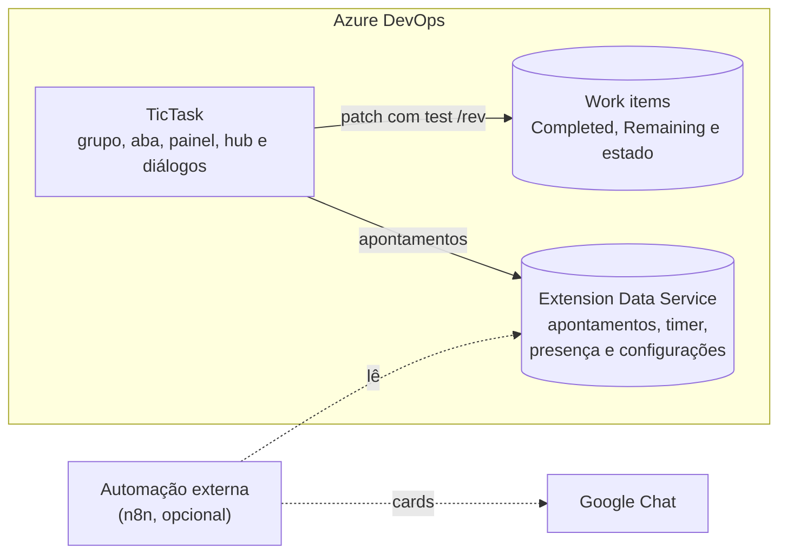

# Arquitetura

O TicTask é só front-end: páginas React carregadas pelo Azure DevOps em iframes. Os apontamentos
ficam no **Extension Data Service** (o armazenamento que o ADO oferece às extensões) e as horas vão
para os campos do próprio work item.

## Contribuições

| Onde | Contribuição | O que faz |
|---|---|---|
| Tela principal do WI (aba Details) | `time-group` | ▶ Iniciar / ⏸ Pausar (▾ com motivo) / ✓ Concluir / + Apontar, cronômetro e Est/Compl/Rest |
| Aba **Apontamentos** do WI | `time-tab` | Task: lista de apontamentos (início/fim/pausas), por pessoa/atividade. US/Bug: tasks filhas com horas, alertas de inconsistência, linha do tempo |
| Backlog e Sprint › painel lateral **TicTask** | `time-backlog-panel` | Timer em andamento, item selecionado no backlog com Iniciar/Apontar e minhas tasks abertas (o ADO não permite extensões na barra superior global) |
| Boards › **TicTask** | `time-hub` | Meu tempo, Resumo, Calendário e, para gestores, Time agora e Configurações |
| Diálogos no host | `time-dialog` | Apontar, pausar, concluir, estimativa, "O que você vai fazer?", tasks padrão |

## Dados

| Coleção / documento | Escopo | Conteúdo |
|---|---|---|
| `te-{projeto}-{yyyyMM}` | Compartilhado | Apontamentos do mês: fonte do Resumo e do Calendário |
| `tw-{projeto}-{workItemId}` | Compartilhado | Índice por work item (mesmo id do apontamento), usado pelas abas |
| `timer/active` | Usuário | Timer em andamento: só o trecho que está rodando (timestamps), por isso continua contando com o navegador fechado |
| `presence-{projeto}` | Compartilhado | Um documento por usuário: status do timer e a última pausa (task e motivo), para o Time agora. Desligável nas Configurações |
| `settings-{projeto}` | Compartilhado | Configurações do projeto |

Cada apontamento guarda início, fim e trechos, usuário, atividade, comentário, motivo (pausa ou
próximo passo), estado e horas da task antes e depois e um histórico de alterações. A exclusão é
lógica (`deleted: true`).

## Regras de horas e estado

- **Completed = soma dos apontamentos da task** (os excluídos não entram). Vale também para horas
  digitadas à mão no formulário ou anteriores à extensão: o próximo apontamento, edição ou exclusão
  regrava a soma. Task sem nenhum apontamento mantém o Completed que tem; ao excluir o último
  apontamento, o Completed volta pelas horas dele.
- **Remaining** = `max(0, Remaining − horas)` (editável no diálogo); task sem estimativa pede a
  estimativa no 1º apontamento. Editar aplica a diferença; excluir devolve as horas ao Remaining.
- **Apontamento e task numa operação só**: o apontamento é salvo primeiro e depois a task. Se a task
  recusar a gravação (regra do processo, campo inválido, permissão), o apontamento é desfeito e a
  pessoa vê um aviso com o motivo. Falhas passageiras (rede, 5xx) são tentadas de novo antes
  (`withRetry`, 3 tentativas). Na tela do work item, se o formulário não salvar, os campos voltam ao
  que eram. O que vem depois da task (mudar o estado numa 2ª revisão, ativar ou comentar no WI pai)
  não desfaz o apontamento: se falhar, aparece um aviso.
- **Leitura logo depois de gravar**: a coleção pode voltar sem o documento recém-gravado. As leituras
  de apontamentos juntam o que a própria página gravou nos últimos minutos, para a soma do Completed
  incluir o apontamento recém-salvo.
- **Conferência**: as telas do work item avisam quando o Completed difere da soma, com **Ajustar**;
  *Configurações › Dados › Conferir o Completed das tasks* faz isso para o projeto todo.
- **Uma revisão por apontamento**: horas, Remaining e estado vão num único patch com `test /rev`
  (em conflito, relê e reaplica). Exceção: quando o apontamento também define a estimativa, são duas
  revisões (estimativa, depois estado), porque o processo pode travar o Original Estimate em Active.
- **Timer**: um por usuário. Iniciar outro pausa o atual (aponta o trecho). Trecho com menos de
  1 minuto não é apontado.
- **Estados**: iniciar → Active; pausar → Stopped; concluir → Closed; apontamento manual numa task
  New → Stopped; iniciar trabalho numa task filha leva o WI pai de New/Ready for Development para Active.
  O diagrama está em [Usar numa Task](Usar-numa-Task.md#estado-da-task).
- **Limite de dias** (padrão 7): depois dele o autor não edita nem exclui o apontamento, e também não
  cria nem move apontamentos para antes dele (exceto o tempo de um timer).

## Gestores

Gestores são os administradores de qualquer time do projeto, mais os e-mails listados em
*Configurações › Gestores*. A checagem usa o escopo `vso.project` que a extensão já tem; o grupo
Project Administrators exigiria `vso.security_manage`, permissão ampla demais.

## Auditoria

- O apontamento guarda o snapshot da task antes e depois, e o histórico de alterações.
- O Completed, o Remaining e o estado têm revisão própria no **History** do work item, que é imutável.
- A exclusão é lógica: o apontamento excluído continua no documento.

## Limitações conhecidas

- O Extension Data Service não valida no servidor: um usuário técnico com acesso pode ler e alterar
  documentos via REST. Mitigações: snapshot antes/depois, revisões do work item, soft delete com
  histórico. Se o compliance exigir trilha à prova de adulteração, o próximo passo é um backend
  (Azure Function + SQL) gravando os apontamentos.
- Só gestores veem e salvam as Configurações, mas a checagem é da interface (o documento
  `settings-{projeto}` pode ser gravado via REST por qualquer membro).
- Bundles de ~0,5–1 MB por página (Fluent UI + FullCalendar); dá para dividir em chunks depois.
