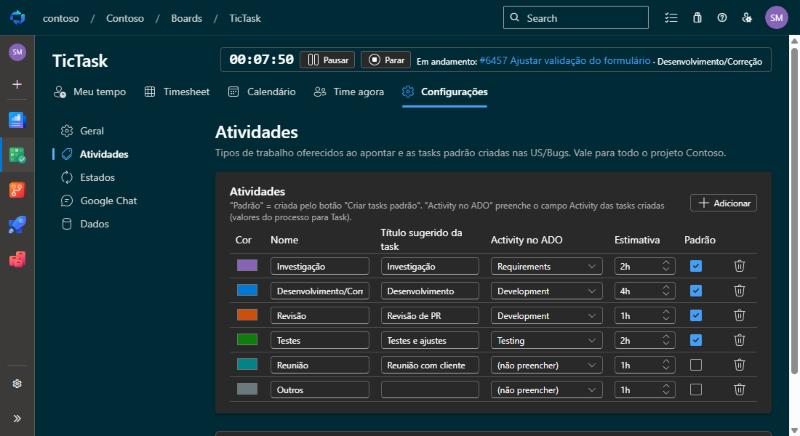
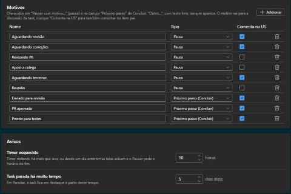

# Configurar o TicTask

As configurações são por projeto, em **Boards › TicTask › Configurações**, e só os gestores veem essa
aba. As alterações só valem depois de **Salvar**, no rodapé, que também tem **Descartar** e
**Restaurar padrão**.

## Gestores

**Gestores** são os administradores de qualquer time do projeto, mais os e-mails adicionados em
*Geral › Gestores*. Eles veem o tempo de todos (Resumo, Calendário), o **Time agora** e as
Configurações.

## Geral

- **Tipos de WI pai**: os tipos de work item em que o grupo funciona como US (por padrão User Story,
  Technical Story e Bug; inclua **Rotina** se usar [rotinas internas](Rotinas-internas.md)).
- **Tipo de task**: o tipo onde as horas são apontadas (por padrão Task).
- **Gestores adicionais**: e-mails que também são gestores.
- **Registrar na discussão**: cada apontamento vira um comentário na task.
- **Dias até bloquear a edição** (padrão 7): depois disso o autor não edita nem exclui o apontamento,
  e também não cria nem move apontamentos para antes dessa data. O tempo de um timer é sempre
  apontado, mesmo que tenha começado antes do limite.
- **Time agora**: liga ou desliga a visão do time (o status do timer de cada pessoa fica visível aos
  gestores).

## Atividades

Nome, cor, título sugerido, campo *Activity* do ADO, estimativa padrão e quais são **tasks padrão**
(criadas pelo botão Tasks padrão da US). O padrão separa **Desenvolvimento** e **Correção**, para o
retrabalho de revisão aparecer à parte.

## Estados e motivos

- **Estados**: o estado ativo (Active) e de quais estados a task vai para ele ao iniciar; os de pausa
  (vale o primeiro que o tipo de task tiver, ex.: Stopped); o de conclusão e os considerados fechados
  (Closed). Estados configurados que o tipo de task não tem são ignorados.
- **Task fechada**: ao iniciar ou apontar numa task Closed, pedir confirmação e reabrir, ou bloquear.
- **Motivos de pausa** e **próximos passos** ao concluir, cada um com a opção **Comenta no WI pai**.
  "Outro…", com texto livre, sempre aparece.
- **Limites**: horas para considerar um timer esquecido (padrão 10h) e dias úteis para destacar uma
  task parada (padrão 5).
- **WI pai**: de quais estados o WI pai vai para Active quando alguém começa a trabalhar numa task dela
  (padrão New e Ready for Development).

## Google Chat

Lembrete de apontamento (expediente, almoço, máximo por dia), quem recebe e o resumo da manhã. O
envio depende de uma automação externa: veja [Lembretes no Google Chat](Lembretes-no-Google-Chat.md).

## Dados

Exportar e importar todos os apontamentos e configurações do projeto (JSON) e importar do Time Log
(CSV). Veja [Migrar dados](Migrar-dados.md).

**Conferir o Completed das tasks** lista as tasks com apontamentos em que o *Completed Work* ficou
diferente da soma deles (por exemplo, editado à mão no formulário), com o Completed atual e a soma.
Marque as que quer corrigir e clique em **Ajustar**: o Completed passa a ser a soma e o Remaining não
muda. Tasks sem apontamento não entram. A conferência lê todos os meses, como a exportação, e pode
levar alguns segundos.
