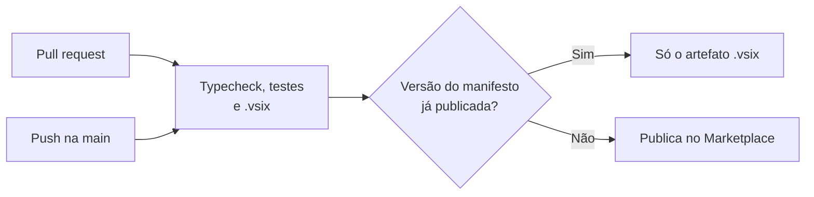

# Contribuir

## Ambiente

```bash
npm install
npm test            # vitest: regras de horas, datas, estado, resumo, CSV, gravação do apontamento e render dos diálogos
npm run typecheck   # tsc
npm run build       # esbuild → dist/<página>.html + .js
npm run package     # gera out/<publisher>.tictask-<versão>.vsix
npm run package:dev # mesma extensão com id tictask-dev (para testar sem afetar a oficial)
```

Stack: TypeScript, React 19, Fluent UI v9, `azure-devops-extension-sdk` 4.2 (a API 5.279 ainda não
aceita o SDK 5), `azure-devops-extension-api`, FullCalendar 6, esbuild e vitest. Interface, wiki e
commits em português; comentários de código em inglês.

Para testar numa organização sua, publique o `package:dev` com o seu publisher (troque `"publisher"`
no manifesto localmente, sem commitar) e compartilhe com uma organização de teste.

## Estrutura

```
src/common/domain   regras puras (horas, Completed, Remaining, estado, resumo, CSV) – testadas
src/common/data     Extension Data: apontamentos, timer do usuário, presença, configurações
src/common/wit      leitura/escrita de work items (form service no WI aberto, REST nos demais)
src/common/actions  orquestra timer, apontar, editar, excluir, criar tasks
src/dialogs         diálogos (abertos no host via openCustomDialog)
src/workitem        grupo da tela principal e aba Apontamentos
src/hub             meu tempo, resumo, calendário, configurações
src/pages           entradas de cada contribuição
docs/wiki           esta wiki (publicada na aba Wiki do GitHub)
docs/img            prints usados na wiki e no site
site                página de apresentação (GitHub Pages)
```

Antes de mexer no código, vale ler [Arquitetura](Arquitetura.md). Armadilhas já resolvidas (não
reintroduza):

- Grave no Extension Data com `__etag: -1`; sem isso, "The document version does not match".
- Logo depois de gravar, uma leitura pode devolver a versão anterior: o timer tem `savedAt` e as telas
  ignoram leituras mais antigas (`isOlder` em `data/timerRepo.ts`).
- Na ponte entre o host e o iframe, `null` vira `undefined` na configuração dos diálogos: use `== null`.
- O diálogo do host tem largura fixa de 480px (440px de conteúdo).
- Menus e popovers no grupo da tela do work item são cortados pelo iframe pequeno: o ▾ do Pausar
  abre um diálogo, não um menu.

## Versão

A cada entrega, suba a versão em `package.json`, `vss-extension.json` e `package-lock.json`, rode
`npx tsc --noEmit -p .`, `npx vitest run` e `npm run package`. O Marketplace não aceita a mesma versão
duas vezes. Atualize a wiki (e os prints, se a tela mudou) no mesmo pull request.

## Pipeline de publicação

O workflow [`publish.yml`](https://github.com/GHMeyer0/azure-devops-tictask/blob/main/.github/workflows/publish.yml)
roda typecheck, testes e `npm run package` em todo pull request. Num push na `main`, publica o `.vsix`
no Marketplace se a versão do manifesto ainda não estiver publicada; sem subir a versão, só testa e
empacota. O `.vsix` de cada execução fica nos artefatos do workflow. Depois do envio, o Marketplace
ainda valida a versão por alguns minutos antes de liberá-la; a pipeline não espera essa validação.



Configuração no GitHub (*Settings* do repositório):

1. *Environments › New environment* `marketplace`. Opcional: *Required reviewers*, para aprovar cada
   publicação.
2. Nesse environment, o secret `MARKETPLACE_PAT`: um PAT do Azure DevOps com *Organization: All
   accessible organizations* e escopo *Marketplace › Publish*, criado por um membro do publisher.
3. Opcional: a variável `MARKETPLACE_SHARE_WITH` com as organizações (separadas por espaço) com que a
   extensão privada é compartilhada a cada publicação. As que já têm acesso continuam com ele.

O PAT expira (no máximo 1 ano): renove o secret antes disso.

## Wiki

As páginas ficam em `docs/wiki/` e são revisadas por pull request, junto com o código. O workflow
[`wiki.yml`](https://github.com/GHMeyer0/azure-devops-tictask/blob/main/.github/workflows/wiki.yml)
copia as páginas para a aba **Wiki** a cada push na `main` que mude `docs/wiki/` ou `docs/img/`.
Edições feitas direto na aba Wiki são sobrescritas.

- Links entre páginas apontam para o arquivo, com a extensão (ex.: `Instalar.md#permissões`): o
  workflow tira o `.md`, e o link funciona tanto no repositório quanto na wiki.
- Imagens ficam em `docs/img/` e são referenciadas como `../img/<arquivo>`: o workflow aponta para o
  arquivo no repositório.
- Diagramas: blocos ` ```mermaid `, que o GitHub renderiza.
- Para o primeiro envio, a wiki precisa existir: em *Settings › Features*, ligue **Wikis**, crie
  qualquer página pela aba Wiki e rode o workflow (*Actions › Publicar wiki › Run workflow*).

## Site

A página de apresentação (<https://ghmeyer0.github.io/azure-devops-tictask/>) fica em `site/`: HTML e CSS
estáticos, sem build, em português (`site/index.html`) e inglês (`site/en/index.html`). O workflow
[`site.yml`](https://github.com/GHMeyer0/azure-devops-tictask/blob/main/.github/workflows/site.yml)
publica no GitHub Pages a cada push na `main` que mude `site/` ou `docs/img/`, copiando os prints de
`docs/img/` para `img/` e o logo de `static/logo.png`.

- Para ver localmente, monte a mesma pasta e sirva com qualquer servidor estático:
  copie `site/` para uma pasta, `docs/img/*` e `static/logo.png` para `img/` dentro dela.
- Mudou um texto ou um recurso? Atualize as duas línguas.
- Na primeira vez: *Settings › Pages › Build and deployment › Source*: **GitHub Actions**.

O botão **Pedir acesso** abre uma issue com o formulário `.github/ISSUE_TEMPLATE/pedir-acesso.yml`:
quem pede informa a organização, e o dono do publisher compartilha a extensão com ela.

## Prints (modo demonstração)

Com `?tictask-demo=1` na URL da página do ADO (hub, work item ou backlog), a extensão troca na tela
títulos, nomes, e-mails, comentários e o nome do projeto por dados fictícios (`src/common/demo.ts`).
Só o que aparece muda: leitura e gravação continuam com os dados reais. Títulos de task com uma ou
duas palavras e os nomes das atividades não são trocados.

A parte da página que é do próprio ADO (organização, projeto, avatar, campos do work item) fica fora
do iframe e precisa ser trocada à parte antes do print. Nada da sua organização deve aparecer.

Teste as telas em 1280×720, 1366×768, 1920×1080 e 1920×1200.

## Licença

[MIT](https://github.com/GHMeyer0/azure-devops-tictask/blob/main/LICENSE).
