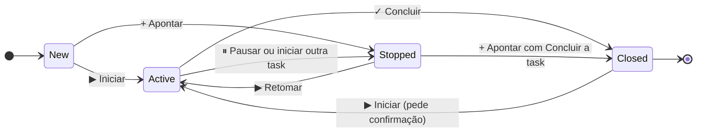

# TicTask

O TicTask é uma extensão do Azure DevOps que registra as horas trabalhadas direto nas **Tasks**. Você
inicia um timer (ou aponta manualmente), e a extensão atualiza sozinha o *Completed Work*, o
*Remaining Work* e o estado da task. Tudo fica no histórico do work item: quem apontou, quanto e
quando. Não há backend: os dados ficam no *Extension Data Service* do próprio Azure DevOps.

> **Resumo rápido**
> 1. Vai trabalhar numa task? Abra a Task (ou a US/Bug) e clique em **▶ Iniciar**.
> 2. Largou a task por agora (outra task, reunião, fim do dia)? **⏸ Pausar**: o tempo já é apontado
>    e a task vai para **Paradas**. Para voltar, **▶ Retomar** nas Paradas.
> 3. Terminou a task? **✓ Concluir**: confira o apontamento e a task é fechada.
> 4. Acompanhe o seu dia em **Boards › TicTask › Meu tempo**.
>
> Pausar não é intervalo: café não precisa pausar. O TicTask mede o esforço em cada task, não é ponto.

## Onde o TicTask aparece

| Onde | O que tem |
|---|---|
| Tela do work item, aba **Details** | Grupo **TicTask** com Iniciar / Pausar / Concluir / Apontar e as horas da task |
| Tela do work item, aba **Apontamentos** | Todos os apontamentos da task (ou das tasks filhas, na US/Bug) |
| **Boards › Backlogs / Sprints**, painel lateral | Timer em andamento, item selecionado e suas tasks abertas |
| **Boards › TicTask** | Meu tempo, Timesheet, Resumo, Calendário e, para gestores, Time agora e Configurações |

Você só pode ter **um timer por vez**. Ele continua contando mesmo com o navegador fechado, porque o
TicTask guarda apenas o horário de início.

## Páginas

**Para quem usa**

- [Usar numa Task](Usar-numa-Task.md): timer, pausar, concluir, apontar, Remaining e estado
- [Usar numa User Story ou Bug](Usar-numa-User-Story-ou-Bug.md): escolher ou criar a task, tasks
  padrão e o fluxo de revisão de PR
- [Rotinas internas](Rotinas-internas.md): treinamento, release notes e trabalho administrativo
- [Telas do TicTask](Telas-do-TicTask.md): aba Apontamentos, painel do backlog e o hub (Meu tempo,
  Timesheet, Resumo, Calendário, Time agora)
- [Lembretes no Google Chat](Lembretes-no-Google-Chat.md)
- [Perguntas frequentes](Perguntas-frequentes.md)

**Para quem administra**

- [Instalar](Instalar.md): publicar, compartilhar e instalar na organização
- [Preparar o processo](Preparar-o-processo.md): estado Stopped, estimativa, tipos pai e Rotina
- [Configurar o TicTask](Configurar-o-TicTask.md): atividades, estados, motivos, limites e gestores
- [Migrar dados](Migrar-dados.md): importar do Time Log e levar os dados para outro publisher

**Para quem desenvolve**

- [Arquitetura](Arquitetura.md): dados, regras de horas e estado, auditoria e limitações
- [Contribuir](Contribuir.md): ambiente, testes, prints, versão, pipeline e esta wiki
