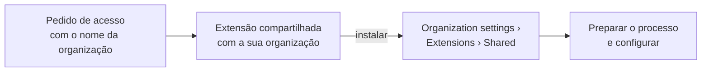

# Instalar

O TicTask é publicado como extensão **privada** no Visual Studio Marketplace, pelo publisher
`ghmeyer0`. Para usar, peça que ela seja compartilhada com a sua organização: você recebe as
atualizações automaticamente, sem manter nada.

## Passo a passo

1. **Peça acesso**: [abra um pedido](https://github.com/GHMeyer0/azure-devops-tictask/issues/new?template=pedir-acesso.yml)
   com o nome da sua organização, o que aparece em `dev.azure.com/<nome>`. O pedido é público; não
   coloque dados sensíveis.
2. **Instale**: quando a extensão for compartilhada, um administrador da organização abre
   *Organization settings › Extensions › **Shared*** › TicTask › **Install** e escolhe a organização.
3. **Prepare o processo**: crie o estado de pausa na Task, se ele não existir. Veja
   [Preparar o processo](Preparar-o-processo.md).
4. **Configure**: em *Boards › TicTask › Configurações*, revise atividades, estados e motivos. Veja
   [Configurar o TicTask](Configurar-o-TicTask.md).

As novas versões chegam sozinhas: não é preciso reinstalar.

## Permissões

A extensão pede os escopos `vso.work_write` (ler e alterar work items), `vso.project` (times e
membros, para saber quem é gestor) e `vso.extension.data_write` (os apontamentos).

## Já usa outra extensão de horas?

Traga o histórico do **Time Log** pelo CSV dele: veja [Migrar dados](Migrar-dados.md).

---

Publicar com outro publisher

 

Só faz sentido se você precisa de uma versão modificada ou não pode depender do publisher
`ghmeyer0`. Você passa a manter a extensão: publicar cada versão, compartilhar e acompanhar as
atualizações do repositório.

1. **Publisher**: crie um em <https://marketplace.visualstudio.com/manage> e troque `"publisher"` em
   `vss-extension.json`: o upload exige que sejam iguais.
2. **Pacote**: `npm install` e `npm run package` geram `out/<publisher>.tictask-<versão>.vsix`.
3. **Publicar**: em *Manage publishers › New extension › Azure DevOps*, faça upload do `.vsix`. Ele
   fica privado.
4. **Compartilhar**: na extensão, *Share/Unshare*, e informe a organização.
5. **Instalar, preparar o processo e configurar**: como no passo a passo acima.

A cada nova versão, aumente `"version"` no manifesto (e no `package.json`) antes de empacotar: o
Marketplace não aceita a mesma versão duas vezes. Para publicar sozinho a cada versão nova, use a
[pipeline do repositório](Contribuir.md#pipeline-de-publicação) com um token do seu publisher.

Outro publisher é outra extensão, com os dados separados: se a sua organização já usa a extensão de
`ghmeyer0`, veja [Migrar dados](Migrar-dados.md#para-outro-publisher) antes de trocar.

