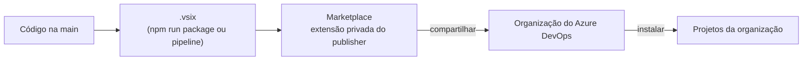

# Instalar

O TicTask é publicado como extensão **privada** no Visual Studio Marketplace e compartilhado com as
organizações que vão usá-lo.

## Passo a passo

1. **Publisher**: o manifesto (`vss-extension.json`) usa o publisher `ghmeyer0`. Para publicar no seu,
   crie um em <https://marketplace.visualstudio.com/manage> e troque `"publisher"` no manifesto: o
   upload exige que sejam iguais.
2. **Pacote**: `npm run package` gera `out/<publisher>.tictask-<versão>.vsix`. No repositório oficial,
   a [pipeline](Contribuir.md#pipeline-de-publicação) publica sozinha a cada versão nova na `main`.
3. **Publicar**: em *Manage publishers › New extension › Azure DevOps*, faça upload do `.vsix`. Ele
   fica privado.
4. **Compartilhar**: na extensão, *Share/Unshare* e informe a organização (ex.: uma org pessoal de
   teste, depois a do time).
5. **Instalar**: na organização, *Organization settings › Extensions › Shared* › TicTask › Install.
6. **Preparar o processo**: crie o estado de pausa na Task, se não existir. Veja
   [Preparar o processo](Preparar-o-processo.md).
7. **Configurar**: em *Boards › TicTask › Configurações*, revise atividades, estados e motivos. Veja
   [Configurar o TicTask](Configurar-o-TicTask.md).

A cada nova versão, aumente `"version"` no manifesto (e no `package.json`) antes de empacotar: o
Marketplace não aceita a mesma versão duas vezes. As organizações recebem a atualização sozinhas.

## Permissões

A extensão pede os escopos `vso.work_write` (ler e alterar work items), `vso.project` (times e
membros, para saber quem é gestor) e `vso.extension.data_write` (os apontamentos).

## Já usa outra extensão de horas?

Traga o histórico do **Time Log** pelo CSV dele: veja [Migrar dados](Migrar-dados.md).
