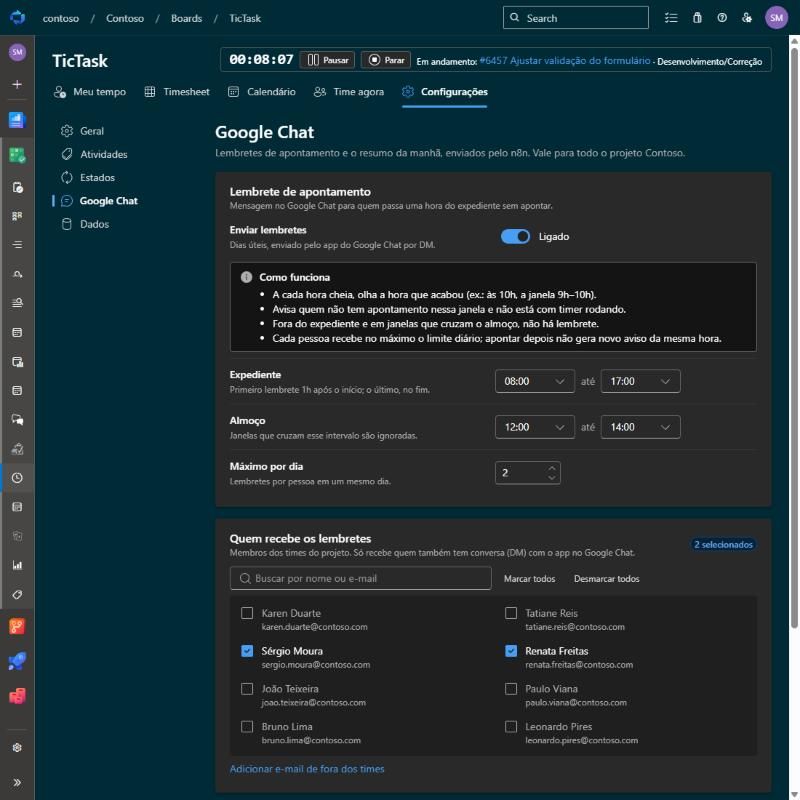
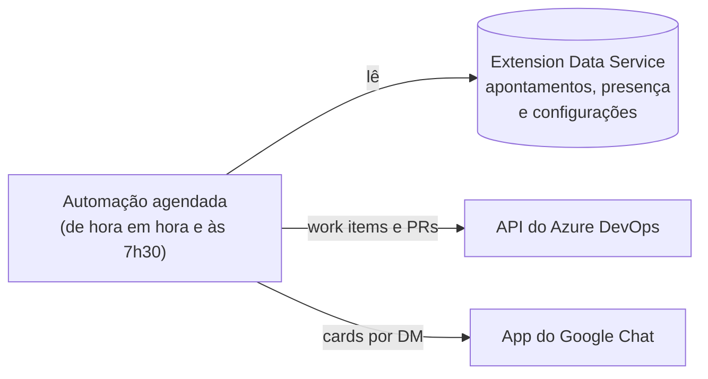

# Lembretes no Google Chat

Configurados em **Configurações › Google Chat** e enviados por mensagem direta pelo app do Google Chat.
O envio depende de uma automação externa que a sua organização precisa ter configurado; sem ela,
esta aba não tem efeito.

## O que chega

**Lembrete de apontamento** (dias úteis):

- A cada hora cheia, o TicTask olha a hora que acabou (ex.: às 10h, a janela 9h–10h).
- Avisa quem **não apontou nada** nessa janela e **não está com timer rodando**.
- Fora do expediente (padrão 8h–17h) e nas janelas que cruzam o almoço (padrão 12h–14h), não há lembrete.
- Cada pessoa recebe no máximo **2 lembretes por dia** (configurável).

**Timer esquecido**: se o seu timer está rodando desde um dia anterior, ou há mais de 10h
(configurável em *Estados e motivos*), chega um aviso no Chat, no máximo um por dia. Ao clicar em
**Pausar**, o TicTask pergunta até que horas você trabalhou.

**Resumo da manhã**: às 7h30 dos dias úteis vem:

- **"O que fiz ontem"**, com os apontamentos do dia útil anterior em árvore (item pai › tasks) para
  ajudar na daily;
- **"Tasks paradas há 5+ dias úteis"** (configurável), com o motivo da última pausa, quando houver.

Para receber, a pessoa precisa estar marcada em **Quem recebe** e ter uma conversa (DM) aberta com o
app no Google Chat.

## Como funciona

A extensão não tem backend e não envia mensagens. Uma automação agendada (hoje, workflows do n8n,
fora deste repositório) lê os documentos do TicTask pela API do Extension Data Service e manda os
cards pelo app do Google Chat.

Ao mudar o formato desses documentos (campos novos em apontamentos, presença ou configurações),
ajuste também a automação. Os documentos estão descritos em [Arquitetura](Arquitetura.md#dados).
