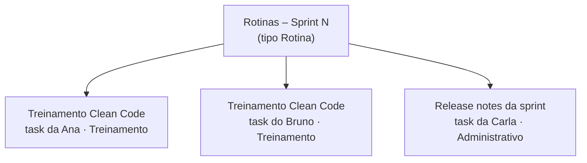

# Rotinas internas

Nem todo trabalho é US, Technical Story ou Bug: treinamento do time, revisar a sprint e montar os
release notes, organização interna. Para apontar esse tempo, use um tipo de work item **Rotina**
(criado uma vez no processo: veja [Preparar o processo](Preparar-o-processo.md#tipo-rotina)).

## Como usar

Em cada sprint existe um item **"Rotinas – Sprint N"** (tipo Rotina). Cada pessoa cria as próprias
tasks embaixo, pelo **▶ Iniciar** ou **+ Apontar** do item → **Nova task**, com um título que diga o
que foi feito e a atividade certa:

| Rotina | Título da task (exemplo) | Atividade |
|---|---|---|
| Treinamento | Treinamento Clean Code | Treinamento |
| Release notes | Release notes da sprint | Administrativo |
| Organização interna | Revisar itens da sprint | Administrativo |

Num treinamento, cada participante cria a sua task: assim o tempo de cada um fica com quem participou.
O total da rotina aparece no próprio item, e o Resumo por WI pai separa esse tempo do
trabalho de produto.

