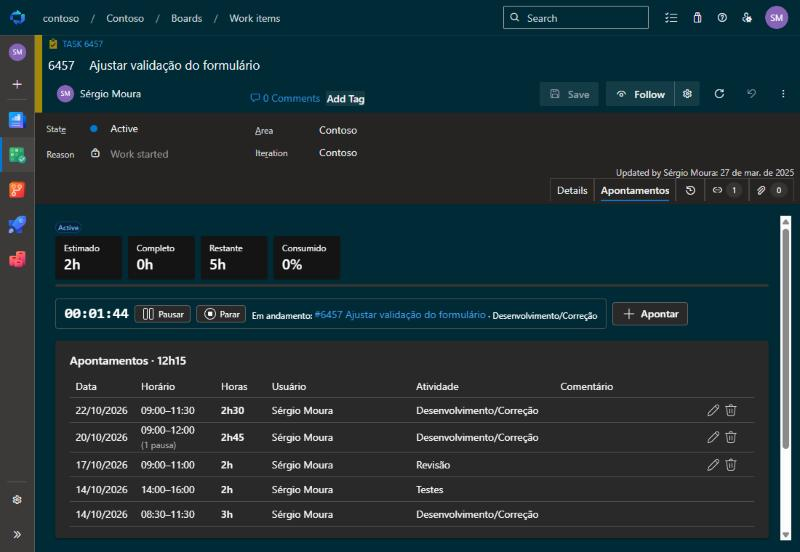
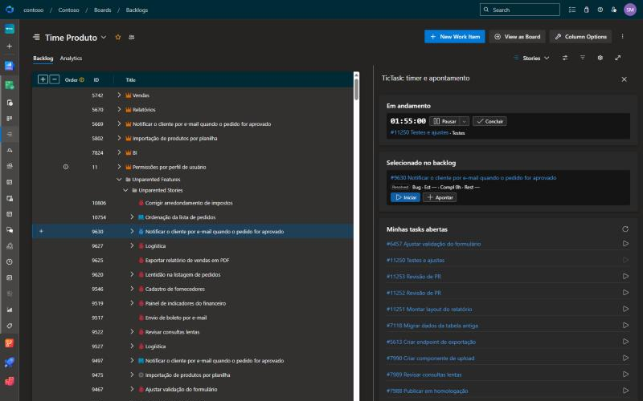
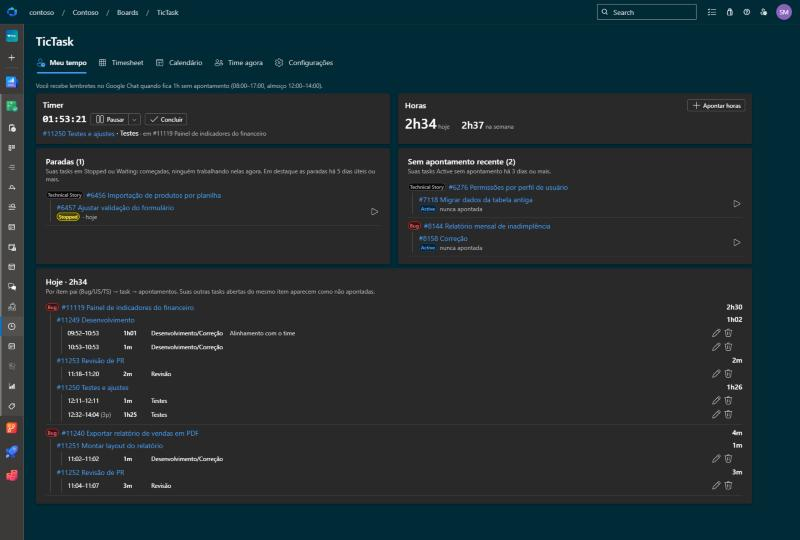
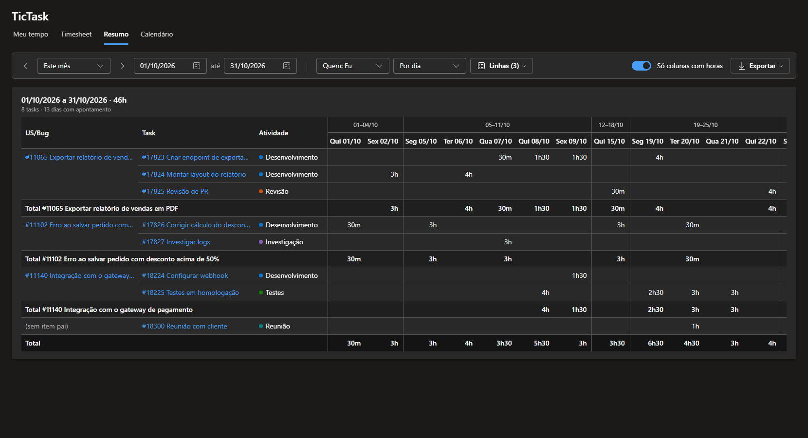
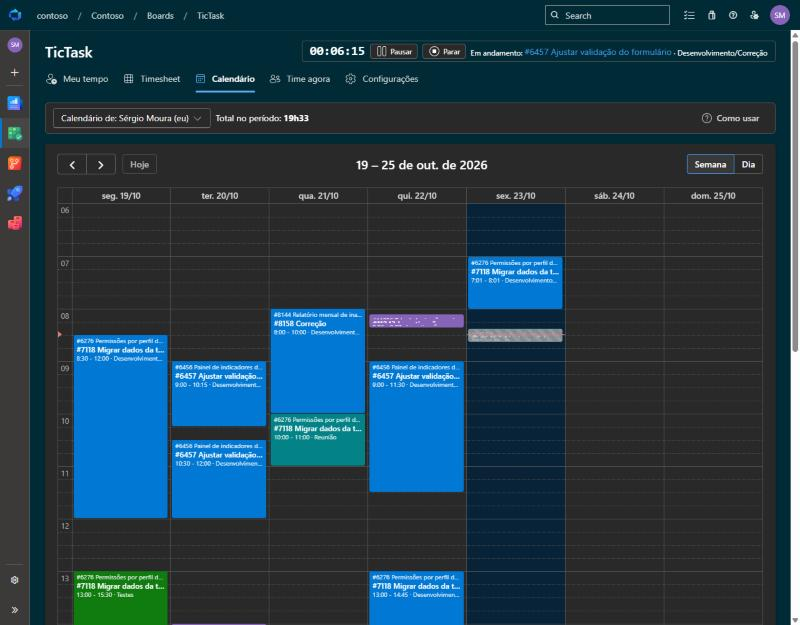
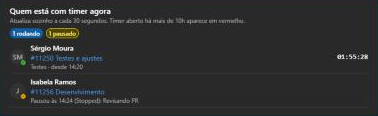

# Telas do TicTask

## Aba Apontamentos

A aba **Apontamentos** do work item mostra o histórico completo:

- **Na Task**: cada apontamento com data, início–fim, pausas, atividade, horas e comentário, com totais
  por pessoa e por atividade. O autor pode editar ou excluir (até o limite de dias configurado).
- **Na US/Bug**: as tasks filhas com estimado, completo e restante, alertas de inconsistência (ex.: task
  fechada com Remaining, task ativa sem apontamento) e a linha do tempo de todos os apontamentos.

## Painel no backlog

Em **Boards › Backlogs** ou **Sprints**, abra o painel lateral (ícone de painel no canto direito) e
escolha **TicTask**. Ele mostra:

- **Em andamento**: o timer atual, com pausar e concluir;
- **Selecionado no backlog**: o item clicado na lista, com **Iniciar** e **Apontar**;
- **Minhas tasks abertas**: as suas 10 tasks abertas mais recentes, com **Iniciar**.

## Hub TicTask

Em **Boards › TicTask** (primeiro item do menu do Boards). Todo mundo vê **Meu tempo**, **Resumo** e
**Calendário** com os próprios apontamentos; gestores veem também os de todo o time, mais
**Time agora** e [Configurações](Configurar-o-TicTask.md).

Desde a 0.11 essas três abas juntam **todos os projetos** da organização que você acessa: quem
trabalha em vários projetos (um por cliente, por exemplo) vê o dia inteiro num lugar só, de qualquer
projeto. As horas de outras pessoas aparecem só nos projetos em que você é gestor. Cada apontamento
segue as configurações do projeto dele (limite de dias para editar, estados, atividades).

### Meu tempo

O painel do seu dia.

- **Timer**: o que está rodando agora, com pausar e concluir (mesmo que a task seja de outro projeto).
- **Horas**: total de hoje e da semana, e o botão **Apontar horas** (escolha a task na lista, agrupada
  pelo WI pai).
- **Paradas**: suas tasks em Stopped, de todos os projetos, com o motivo da última pausa e há quantos dias úteis estão
  paradas. A partir de 5 dias úteis (configurável), o tempo fica em destaque. O **▶** retoma a task.
- **Sem apontamento recente**: suas tasks Active sem apontamento há 3 dias ou mais.
- **Hoje**: os apontamentos do dia em árvore (WI pai › task › apontamentos), com editar e excluir.
  Suas outras tasks abertas do mesmo WI pai aparecem como "não apontada hoje", com ▶ para iniciar.
- Um WI pai de outro projeto vem com o nome do projeto antes dele.

### Resumo

As horas do período numa tabela só: uma linha por pessoa, projeto, WI pai e atividade, e uma coluna por
dia, semana ou mês. Bom para fechar o mês, ver onde foi o tempo de uma história ou passar o dia para
outro sistema de horas. **WI pai** é o
work item acima da task (User Story, Bug, Rotina…: os tipos de *Configurações › Geral › Tipos de WI
pai*). Até a versão 0.8 havia também a aba Timesheet, que virou o Resumo.

- **Período**: esta semana, semana passada, este mês ou mês passado; **◀ ▶** anda um mês (ou uma
  semana) e **De / até** escolhe qualquer intervalo.
- **Projetos**: **Todos os projetos** (padrão) junta as suas horas de todos os projetos que você
  acessa; **Este projeto** fica só no projeto aberto.
- **Colunas**: por dia (agrupadas por semana), por semana ou por mês. **Só colunas com horas** esconde
  os dias sem apontamento.
- **Linhas**: escolha quais colunas formam as linhas, entre Pessoa, Projeto, WI pai, Task e
  Atividade. O padrão é Pessoa, Projeto, WI pai e Atividade. Desmarcando Atividade, por exemplo, fica
  uma linha por WI pai. Valores repetidos aparecem uma vez só, e cada pessoa (ou projeto, ou WI pai, a
  primeira coluna) tem o seu total.
- As colunas da esquerda ficam fixas ao rolar para os lados. Clique na task ou no WI pai para abri-lo.
- **Detalhado**: lista cada apontamento do período abaixo da tabela, com horário, projeto, atividade e
  comentário. Os seus têm **editar** e **excluir** (até o limite de dias do projeto do apontamento).
- **Exportar**:
  - **Resumo (PDF)**: a tabela como está na tela (linhas, colunas e filtros escolhidos), em A4
    deitado, com período, quem, total, quem gerou e quando, e número de página. Bom para enviar ou
    arquivar o fechamento do mês. Num período longo por dia, as colunas continuam nas páginas
    seguintes, repetindo pessoa, WI pai, task e atividade.
  - **Resumo (CSV)** e **Apontamentos detalhados (CSV)**: para abrir no Excel (com o projeto de cada
    apontamento).
- Gestores escolhem **Quem** (eu, todos ou um time) e, dentro dele, uma **Pessoa**. Com Todos os
  projetos, as horas de outras pessoas entram só dos projetos em que você é gestor.
- Todas as escolhas (período da lista, projetos, quem, pessoa, colunas, linhas, Só colunas com horas e
  Detalhado) ficam lembradas no navegador. O período volta pela escolha da lista: "Este mês" abre
  sempre no mês atual.

### Calendário

Seus apontamentos na semana ou no dia, de todos os projetos, como uma agenda. Cada bloco mostra o item
pai, a task, o horário e a atividade (e o projeto, quando a semana tem horas em mais de um).

- **Arraste num horário vazio** para apontar naquele intervalo (numa task do projeto aberto; para outro
  projeto, abra o TicTask nele ou use **Duplicar** num bloco de lá).
- **Arraste ou redimensione um bloco** para corrigir o horário (Completed e Remaining da task são
  ajustados).
- **Clique num bloco** para editar, duplicar ou excluir.
- O timer em andamento aparece como um bloco listrado.
- Gestores escolhem em **Calendário de** de quem é a agenda (a de outras pessoas é só leitura e mostra
  os projetos em que você é gestor).

### Time agora (gestores)

Quem está com timer rodando, em qual task (e item pai) e desde quando, e quem pausou por último (com o
estado e o motivo). Atualiza a cada 30 segundos; timer aberto há mais de 10h (configurável) aparece em
vermelho (provável esquecimento).

