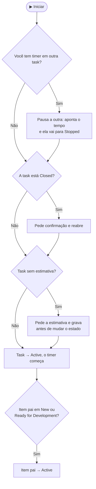
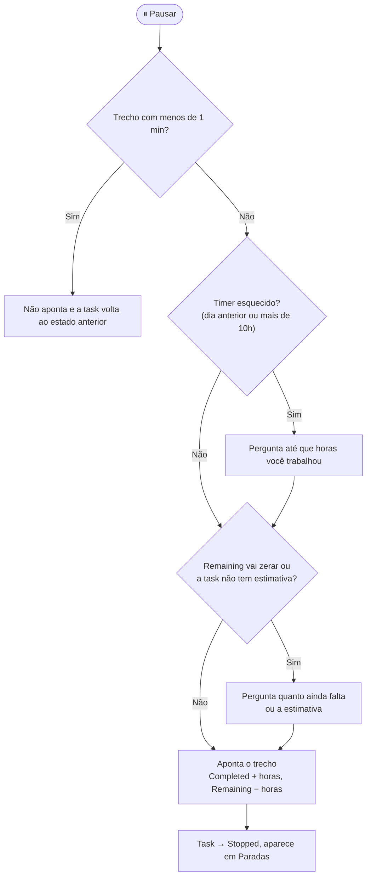
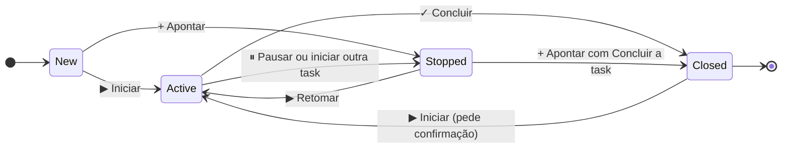

# Usar numa Task

## Timer: iniciar, pausar e concluir

Na aba **Details** da Task, o grupo **TicTask** mostra os botões do timer e um resumo das horas
(**Est**imado · **Compl**eto · **Rest**ante), com uma barra de quanto da estimativa já foi consumido.

| Botão | Quando usar | O que acontece |
|---|---|---|
| **▶ Iniciar** (ou **▶ Retomar**, nas Paradas) | "Vou trabalhar nisso agora" | O timer começa e a task vai para **Active**. Se você tinha um timer em outra task, ele é pausado sozinho. |
| **⏸ Pausar** | "Larguei esta task por agora, mas não terminei": outra task, reunião, revisão, aguardando alguém, almoço, fim do dia | Um clique: o tempo é apontado, sai do Remaining, a task vai para **Stopped** e aparece em **Paradas**. |
| **⏸ ▾** (seta do Pausar) | Igual, quando vale registrar o porquê | Abre o diálogo de motivo. Veja [Pausar com motivo](#pausar-com-motivo). |
| **✓ Concluir** | "Terminei esta task" | Abre o apontamento para conferir o horário e o Remaining (sugerido 0). A task vai para **Closed**. |
| **+ Apontar** | Esqueci o timer, ou é trabalho já feito | Abre o apontamento manual. |

O que acontece ao clicar em **▶ Iniciar**:

Cada pausa vira uma linha de apontamento. Exemplo: iniciou às 11:30, pausou às 11:45, retomou às 12:15 e
pausou de novo às 14:00. São duas linhas (11:30–11:45 e 12:15–14:00), 2h no total. O intervalo entre
elas é o tempo em que você não estava na task, e não é descontado.

- Se outra pessoa estiver com timer na mesma task, o TicTask avisa (e deixa iniciar mesmo assim).
- Um timer pausado com menos de 1 minuto (clique sem querer) não gera apontamento, e a task volta ao
  estado anterior.
- **Timer esquecido**: se o timer está rodando desde um dia anterior, ou há mais de 10h
  (configurável), as telas avisam e o **Pausar** pergunta até que horas você trabalhou, para não
  apontar a noite toda.

O timer em andamento também aparece no topo do **Meu tempo** e no **painel do backlog**, então dá para
pausar ou concluir sem voltar à task.

## Pausar com motivo

A seta **▾** ao lado do **Pausar** abre o diálogo com os motivos. O motivo e o detalhe (ex.:
"PR !1234 do João") vão para a discussão da task: `⏸ Pausada: Aguardando revisão. PR !1234 do João`.
Também aparecem em **Paradas**, ao lado da task.

| Motivo | Quando usar | Também comenta na US |
|---|---|---|
| Aguardando revisão | Subi o PR (ou as correções) e espero a revisão | Sim |
| Aguardando correções | Revisei o PR e espero o autor ajustar os comentários | Sim |
| Revisando PR | Parei a minha task para revisar o PR de alguém | Não |
| Apoio a colega | Parei para ajudar alguém | Não |
| Aguardando terceiros | Dependo de cliente, infra ou uma dúvida de negócio | Sim |
| Reunião | Saí para uma reunião | Não |
| Outro… | Escreva o motivo | Não |

Os motivos marcados com "Também comenta na US" escrevem também na discussão da US/Bug, para quem
acompanha a história: `⏸ #11222 Correção (Ana): Aguardando revisão. PR !1234`. Os outros ficam só na
task, para não notificar todo mundo que segue a US. A lista é configurável em
[Configurações › Estados e motivos](Configurar-o-TicTask.md#estados-e-motivos).

Em "Revisando PR" e "Apoio a colega", o tempo da revisão ou da ajuda vai numa task da revisão ou da
ajuda, com timer nela. O motivo só explica por que a sua task parou.

O diálogo de pausa também abre sozinho quando há algo a confirmar:

- **Timer esquecido**: pede até que horas você trabalhou.
- **Remaining zerado**: se a task já estava com Remaining 0, ou a pausa vai zerá-lo, o TicTask pergunta
  **"Quanto ainda falta nesta task?"**. Informe o valor real, ou clique em **Na verdade terminei:
  Concluir**. Assim o estouro da estimativa aparece (Completed maior que o estimado) em vez de ficar
  escondido num Remaining 0.
- **Task sem estimativa**: pede a estimativa.

## Concluir e próximo passo

**✓ Concluir** abre o apontamento com o horário do timer e o Remaining sugerido como 0 (dá para
mudar). Em **Próximo passo**, opcional, diga o que vem depois:

| Próximo passo | Quando usar |
|---|---|
| Enviado para revisão | Terminei o desenvolvimento e abri o PR |
| PR aprovado | Revisão terminada, ou correções aprovadas |
| Pronto para testes | Entreguei para o QA |
| Outro… | Escreva o próximo passo |

O próximo passo vai para a discussão da task e da US: `✓ #11221 Desenvolvimento concluída (Ana):
Enviado para revisão. PR !1234`. Sem próximo passo, a task é concluída sem comentário.

Cancelar o diálogo não perde nada: o timer continua rodando.

## Apontar horas manualmente

Use **+ Apontar** para registrar algo que você já fez sem o timer.

| Campo | Como funciona |
|---|---|
| **Data, De, Até** | Quando foi o trabalho. Ao mudar o início ou a duração, o fim é recalculado. A data vai até o limite de dias de *Configurações › Geral* (padrão 7): um apontamento mais antigo não poderia mais ser corrigido nem excluído. |
| **Duração** | Aceita `1h30`, `1,5`, `90m`. Os atalhos 30m / 1h / 2h / 4h preenchem na hora. |
| **Atividade** | Investigação, Desenvolvimento, Revisão, Testes, Correção, Reunião, Outros. Vem sugerida pelo título da task. |
| **Comentário** | O que foi feito (opcional). |
| **Remaining após apontar** | Calculado automaticamente; pode ser ajustado. |
| **Concluir a task** | Marque se o trabalho terminou: a task vai para Closed e você pode informar o próximo passo. Se o Remaining zerar, o diálogo lembra dessa opção. |

Um apontamento manual não deixa a task em Active, porque ninguém está trabalhando nela agora: uma task
New vai para **Stopped** (e aparece em Paradas).

No **Concluir**, os campos de horário vêm do timer. Para corrigi-los à mão, clique em **editar horário
manualmente**.

## Remaining automático

A cada apontamento:

- **Completed Work** = Completed + horas apontadas
- **Remaining Work** = Remaining − horas apontadas (nunca abaixo de zero), **editável** no diálogo

Se a task ainda não tem **Original Estimate**, o primeiro apontamento pede a estimativa. Editar um
apontamento aplica só a diferença; excluir devolve as horas ao Remaining.

Horas, Remaining e estado vão numa única gravação, o que gera uma só revisão no **History** do work
item. A exceção é o primeiro apontamento de uma task sem estimativa: a estimativa é gravada antes e o
estado depois, porque o processo pode não deixar mudar a estimativa com a task em Active.

## Estado da task

O estado da task mostra quem está trabalhando nela:

| Estado | Significa |
|---|---|
| **Active** | Alguém está com o timer nela agora |
| **Stopped** | Começada, ninguém trabalhando nela agora (aparece em **Paradas**) |
| **Closed** | Terminada |

| Quando | O que acontece |
|---|---|
| Iniciar o timer numa task **New / Stopped** | A task vai para **Active**. Sem estimativa, o TicTask pede a estimativa antes (o processo pode exigir Original Estimate e Remaining para sair de New) |
| Iniciar trabalho numa task filha de uma US em **New / Ready for Development** | A US vai para **Active** |
| Pausar | A task vai para **Stopped** |
| Concluir, ou apontar marcando **Concluir a task** | A task vai para **Closed** |
| Apontar manualmente numa task **New** | A task vai para **Stopped** |
| Iniciar ou apontar numa task **Closed** | Pede confirmação e reabre (ou bloqueia, conforme a configuração) |

Os estados usados são configuráveis em
[Configurações › Estados e motivos](Configurar-o-TicTask.md#estados-e-motivos). O processo precisa ter
o estado de pausa (por padrão **Stopped**): veja [Preparar o processo](Preparar-o-processo.md).

## Trocar de task no meio do trabalho

Só existe um timer por pessoa. Para começar outra coisa, clique em **▶ Iniciar** na outra task: o
timer atual é **pausado sozinho** (o tempo dele é apontado e a task vai para Paradas) e o novo começa.
Um aviso no rodapé da página confirma quanto foi apontado.

Para voltar, use **▶ Retomar** em **Paradas** (Meu tempo) ou **▶ Iniciar** na própria task.

### Exemplo: revisar um PR no meio do seu trabalho

Você está com o timer na sua task (#100 Desenvolvimento). Um colega pede revisão do PR dele (US #200).

1. Na US #200, **▶ Iniciar** → **Nova task** com a atividade *Revisão* (ou a task de revisão que já
   existe). A sua #100 é pausada sozinha.
2. Revise o PR. Terminou e deixou comentários? **⏸ ▾ Pausar com motivo** → **Aguardando correções**.
   A revisão vai para Paradas e a US recebe o comentário.
3. Em **Paradas**, **▶ Retomar** na #100.
4. Quando o colega avisar que corrigiu: **▶ Retomar** na revisão (a #100 é pausada sozinha). Aprovou?
   **✓ Concluir** com o próximo passo **PR aprovado**.

O fluxo completo, com a task de Correção, está em
[Usar numa User Story ou Bug](Usar-numa-User-Story-ou-Bug.md#fluxo-de-revisão-de-pr).
