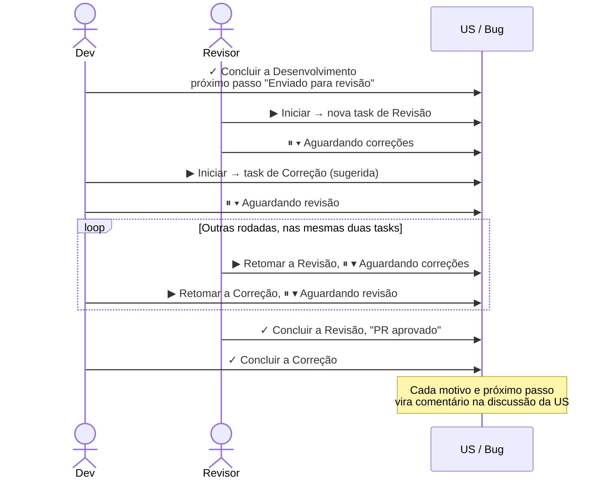

# Usar numa User Story ou Bug

Na US, Technical Story ou Bug, o grupo **TicTask** soma as horas das tasks filhas e oferece
**▶ Iniciar**, **+ Apontar** e **Tasks padrão**.

Se o seu timer estiver rodando em outra task, ele aparece logo abaixo dos botões, com pausar e concluir.

## "O que você vai fazer?"

**▶ Iniciar** e **+ Apontar** na US/Bug abrem este diálogo:

- **Minhas tasks**: as suas tasks abertas na US. Escolha uma e confirme a atividade.
- **Outras tasks**: as tasks de outras pessoas (expanda para ver).
- **Nova task**: escolha a atividade, a estimativa e escreva a descrição, que vira o título da task
  (ex.: `Revisão: Revisão de PR`). A task nasce **atribuída a você**, com a mesma área e iteração da US.
- Se faltarem tasks padrão na US, dá para marcar **Criar também as tasks padrão que faltam**.
- Se você já concluiu uma task sua na US (ex.: o Desenvolvimento, enviado para revisão), o diálogo
  sugere a sua task de **Correção**, ou uma nova com essa atividade.

Depois de confirmar, o timer começa (ou o apontamento abre) na task escolhida ou criada.

## Tasks padrão

**Tasks padrão** cria de uma vez as tasks combinadas para toda US/Bug (marcadas como "Padrão" em
*Configurações › Atividades*, por exemplo Desenvolvimento e Testes), com estimativa e título
sugeridos. Só aparecem as que ainda faltam na US.

## Fluxo de revisão de PR

A sugestão do TicTask: a task de **Desenvolvimento** é concluída quando o PR vai para revisão, e todas
as rodadas de correção vão numa **única task de Correção** por história. Assim a estimativa do
desenvolvimento fica limpa, e o retrabalho de revisão aparece separado no Resumo.

| Quem | Ação | Resultado |
|---|---|---|
| Dev | **✓ Concluir** a Desenvolvimento, próximo passo **Enviado para revisão**, detalhe "PR !1234" | Desenvolvimento Closed. Comentário na US |
| Revisor | Na US, **▶ Iniciar** → **Nova task** de **Revisão** | A task de revisão é criada atribuída ao revisor |
| Revisor | **⏸ ▾ Aguardando correções** | Revisão Stopped. Comentário na US |
| Dev | Na US, **▶ Iniciar** → a task de **Correção** já vem sugerida (nova na 1ª rodada) | Correção Active |
| Dev | **⏸ ▾ Aguardando revisão** | Correção Stopped. Comentário na US |
| Revisor | **▶ Retomar** a revisão em Paradas; se houver mais comentários, **Aguardando correções** de novo | As rodadas seguintes usam as mesmas duas tasks |
| Dev | **▶ Retomar** a Correção em Paradas | A mesma task, sem criar outra |
| Revisor | **✓ Concluir** a revisão, próximo passo **PR aprovado** | Revisão Closed. Comentário na US |
| Dev | **✓ Concluir** a Correção | Correção Closed |

Se alguém iniciar o timer na task de Desenvolvimento já concluída, o TicTask pergunta se quer usar a
task de Correção (e a cria, se não existir) ou reabrir a de Desenvolvimento mesmo assim.

## Ajudar alguém no meio do seu trabalho

Você está com o timer na sua task e precisa ajudar um colega na US dele:

1. Na US do colega, **▶ Iniciar** → **Nova task** (ex.: atividade *Outros*, descrição "Apoio ao
   fulano"). A sua task é pausada sozinha.
2. Ajude o colega e, ao terminar, **✓ Concluir** a task de apoio.
3. Volte para a sua task em **Paradas** com **▶ Retomar**.

Se esqueceu de iniciar o timer na ajuda, aponte depois com **+ Apontar** na US do colega.
